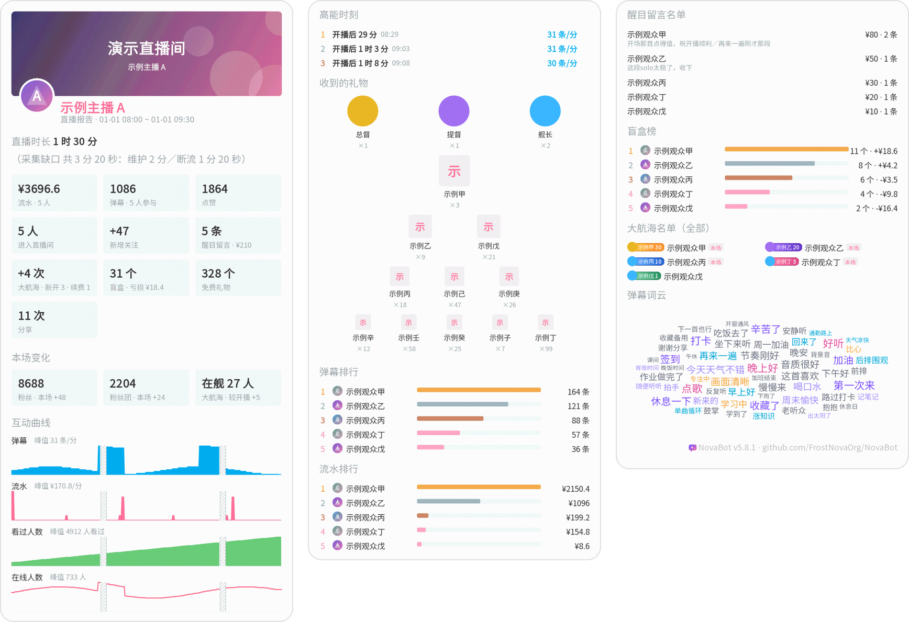
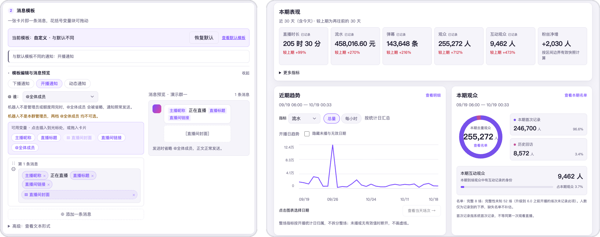

<div align="center">


<h3>Bilibili live stream and feed notification bot</h3>

<p>Pushes go-live, stream-end and new-post notifications to QQ groups and friends as soon as they happen;<br>generates a data report image automatically when a stream ends, with all configuration done in the browser.</p>

<p><a href="README.md">简体中文</a> · English</p>
<p>
<a href="https://github.com/FrostNovaOrg/NovaBot/actions/workflows/ci.yml"></a>
<a href="https://github.com/FrostNovaOrg/NovaBot/releases"></a>
<a href="LICENSE"></a>

</p>

<p>
<a href="https://frostnovaorg.github.io/NovaBot/index.html"><b>User manual</b></a>
&nbsp;&nbsp;·&nbsp;&nbsp;
<a href="#quick-start">Quick start</a>
&nbsp;&nbsp;·&nbsp;&nbsp;
<a href="CHANGELOG.md">Changelog</a>
&nbsp;&nbsp;·&nbsp;&nbsp;
<a href="templates/nova-example-plugin">Plugin template</a>
</p>

<br>

<a href="docs/assets/report-demo.png"></a>

<p><sub>The report image generated automatically after a stream ends (sample data; click to see the full-size image)</sub></p>

</div>

## What it does

<table>
<tr>
<td width="50%" valign="top">
<b>Notifications</b><br>
Three kinds of notifications: going live, ending a stream, and feed updates. One streamer can be pushed to several groups or friends, message templates are configured per push target, and quiet hours have one global setting that can also be set separately for each group or friend chat.
</td>
<td width="50%" valign="top">
<b>Reports</b><br>
A data report image is generated automatically when a stream ends, and trends can be viewed by week or by month. Mentioning the bot with @ in a group also lets you look up data, pull leaderboards, or ask for a live image.
</td>
</tr>
<tr>
<td width="50%" valign="top">
<b>Console</b><br>
Adding streamers, editing templates and sending test messages are all done in the browser. The home page shows what was pushed today, and when something goes wrong there is a health self-check with suggested fixes.
</td>
<td width="50%" valign="top">
<b>Extensions</b><br>
Live room events can be forwarded to other programs on the same machine, and you can write your own plugins to handle danmaku, gifts and guard memberships.
</td>
</tr>
</table>

<p align="center">

<br>
<sub>Build message templates from drag-and-drop blocks in the console, with a live preview on the right; view each streamer's trends by week / by month (sample data)</sub>
</p>

> [!NOTE]
> NovaBot is meant for small and mid-sized guilds, independent streamers and the people who run their channels, to look after live rooms they own or are authorized to manage. It does not try to get around the platform's risk controls, and it is not suited to unauthorized large-scale data collection. If you are not sure whether it fits your case, read [Chapter 1](https://frostnovaorg.github.io/NovaBot/01-what-novabot-does.html) first.

## Quick start

You need a machine that can stay on for long periods (Linux, macOS or Windows, with 1 GB of memory or more), with [NapCat](https://github.com/NapNeko/NapCatQQ) installed and logged in to QQ. NovaBot sends messages through [OneBot](https://onebot.dev/) and does not log in to QQ itself.

The one-step install script supports Linux only. It recognizes the apt-get, dnf, yum, zypper, pacman and apk package managers, and uses them to install Java 17 or Chinese fonts automatically if they are missing; Maven (3.9 or later), which is used for the build, has to be installed by yourself beforehand. On machines with systemd, the script also sets up the service.

```bash
git clone https://github.com/FrostNovaOrg/NovaBot
cd NovaBot && ./install.sh
```

After installation, follow [Chapter 4](https://frostnovaorg.github.io/NovaBot/04-first-open.html) to open the console and go through the five steps of the initial setup, and the group will receive its first message. On macOS and Windows, install manually; a Docker deployment is also available. See [Chapter 3](https://frostnovaorg.github.io/NovaBot/03-install.html).

## Documentation

The user manual and the console interface are currently available in Chinese only.

| I want to… | Read this |
|---|---|
| Decide whether it suits me | [Chapter 1: What NovaBot can do for you](https://frostnovaorg.github.io/NovaBot/01-what-novabot-does.html) |
| Prepare a machine and estimate memory | [Chapter 2: What to prepare before you start](https://frostnovaorg.github.io/NovaBot/02-what-to-prepare.html) |
| Add streamers and push to groups | [Chapter 6: Add streamers and push to groups](https://frostnovaorg.github.io/NovaBot/06-add-streamer-and-push.html) |
| See stream reports and trends | [Chapter 9: How your streams went](https://frostnovaorg.github.io/NovaBot/09-stream-reports.html) |
| Upgrade and back up | [Chapter 13: Upgrades and backups](https://frostnovaorg.github.io/NovaBot/13-upgrade-and-backup.html) |
| Solve a problem | [Chapter 14: What to do when something goes wrong](https://frostnovaorg.github.io/NovaBot/14-troubleshooting.html) |

For the other chapters, see the [user manual contents](https://frostnovaorg.github.io/NovaBot/index.html). For problems and suggestions, please open an [Issue](../../issues) and attach the relevant excerpt from the console's Logs page (「日志」) or from `journalctl -u novabot@<version>`.

## Contributing

- **Building and submitting changes**: [Contributing guide](CONTRIBUTING.md)
- **Module structure and build order**: [Architecture](docs/architecture.md)
- **Writing plugins**: start from a copy of [templates/nova-example-plugin](templates/nova-example-plugin); for dependencies see the [template README](templates/nova-example-plugin/README.md)
- **More**: [Event source protocol](docs/protocol.md) · [Performance measurements](docs/performance.md) · [Security](SECURITY.md) · [Connecting a real event stream](docs/runbook-local-source.md) · [Protocol corpus replay](docs/runbook-protocol-corpus.md)

## License

[AGPL-3.0](LICENSE). This project is developed on the basis of LWR's StarBot and has been maintained independently since 2026-08-03; see [NOTICE](NOTICE) for the upstream copyright notice.
