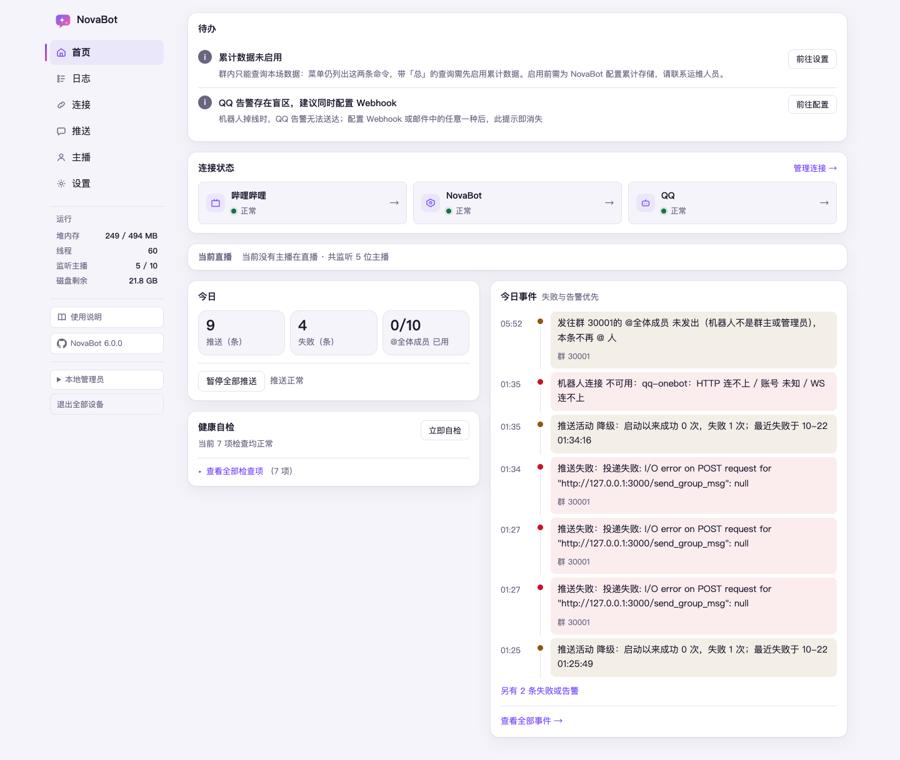

# 第 5 章　认识控制台

上一章走完了设置引导，这一章把控制台每一页认一遍：哪页管什么、出了事先看哪。
这是一张地图，具体的活儿（加主播、改文字、管群）从下一章开始讲。
先从屏幕左边那条侧栏说起。

## 左边这条侧栏

控制台没有顶栏。左边一条侧栏从上到下是：NovaBot 的名字、六页导航、「运行」四行、
「使用说明」与版本号两枚按钮，最底下是退出登录的按钮；页面本身占剩下的全部宽度。

「使用说明」按你正在看的这一页，在新标签页打开手册里对应的那一章。

左栏底部还有显示当前身份的个人菜单，账户中心与退出入口见[第 15 章](15-members.md#我要看当前身份、去账户中心或退出)。

六页各回答一个问题：

| 页 | 回答什么 |
|---|---|
| **首页** | 现在好不好：健康自检、今日三个数、暂停推送 |
| **日志** | 今天发生了什么：一条按天翻的时间线，给人看的，不是程序日志 |
| **连接** | 这台机器与外面的连接通不通：直播平台、机器人、外部面板；还有「发送测试消息」 |
| **推送** | 推谁、推到哪、推什么，按主播管（[第 6 章](06-add-streamer-and-push.md)） |
| **主播** | 播得怎么样：点一位主播看一页总览，场次、趋势、开播节奏、观众名单在抽屉里看（[第 9 章](09-stream-reports.md)） |
| **设置** | 调参数，按你要办的事分组 |

「运行」四行是给机器看的：堆内存、线程数、监听主播数、磁盘剩余。它们回答的是「这台
机器还撑得住吗」，平时不用管，感觉卡的时候再来看。「磁盘剩余」量的是数据目录所在的
那块盘：不到 2GB 变黄、不到 500MB 变红，鼠标放上去有一句说明——盘写满了，推送记录
和报告就会丢；量不出来时显示「—」。

侧栏最底下是「退出登录」和「退出全部设备」，只在设了登录密码的机器上出现——
没上锁的控制台谈不上退出。两枚按钮各退掉什么，见[第 12 章](12-settings.md#退出登录)。

手机等窄屏上，侧栏变成页面顶上的横条：第一行左边是 NovaBot，右边是「我的」，第二行是导航。
「使用说明」、个人菜单（显示当前身份，点开有「退出」）和「退出全部设备」都收在「我的」里，点一下摊开，
再点一下、按 Esc 或点别处收起。

## 首页怎么看

首页回答一个问题：现在好不好。从上往下读；宽屏下今日与健康自检在左列、今日事件在右列，窄屏依次排列：

1. **出事时的横条**——只在出事时出现，平时没有它
2. **待办**——需要人动手的事，比如设置引导还没走完
3. **连接状态**——直播平台、本机、机器人三个状态入口，哪处黄了红了就点哪处：
   点平台或机器人去「连接」页，点本机展开下面的健康自检
4. **当前直播**——在播的每位一行：名字、播了多久、直播间号、推往几处；一个都没播时是一句说明
5. **今日**——三个数：推了几条、失败几条、@全体成员 用了几次。旁边的
   **「暂停全部推送」**是全局刹车，按下立即生效：推送、群命令回复与机器人告警均不发送，暂停期间的消息不会补发，按钮变成
   「恢复推送」，再按一下就恢复
6. **健康自检**——先显示异常、需关注或状态未知的摘要，点「查看全部检查项」展开各项探针；新的严重异常会自动展开。拿不准时点「立即自检」，它会展开明细并答一句
   「自检完成，7 项全部正常」（默认插件齐全时共 7 项），或者「2 项异常：××、××」——异常的是哪几项，点名道姓。
   「哔哩哔哩自动关注」会写明关注不了的主播及 B 站原因：他们的动态推不出来，直播推送不受影响。常见原因是主播把这个账号拉黑或移出了粉丝，或者改了隐私设置；NovaBot 每天会自动再试，能做的只有换一个能关注他的账号登录，或者请主播调整设置。推送名单里有登录账号自己时，自动关注会跳过他，健康栏也不会把他列为关注不了。
7. **今日事件**——失败与告警置顶，再带最近几条；看全部去日志页

## 版本与新版提示

侧栏下方的版本号，就是这台机器正在跑的版本。版本号前带 GitHub 标，整枚是一个按钮，
点一下新开一页，去 NovaBot 的源码仓库。有新版值得提示时，版本号下面会出现
一枚「新版本 x.y.z」药丸；点开是一个小面板，里面是这版更新了什么、「查看完整更新说明」
的链接，和一枚「此版本不再提醒」——按版本记在这台机器上，点了这版就不再催，
出了下一版会再出现。

控制台**不做在线更新**：看到新版后，到服务器上重跑一遍安装脚本就是升级，
见[第 13 章　升级与备份](13-upgrade-and-backup.md)。

## 深色与浅色

设置页最上面的「界面」组里点一下就换，不用保存，
见[第 12 章](12-settings.md#换深色、浅色)。

## 接下来

页面认完了，开始干活：先加第一位主播、把消息推到群里，
见[第 6 章　加主播、推到群](06-add-streamer-and-push.md)。
