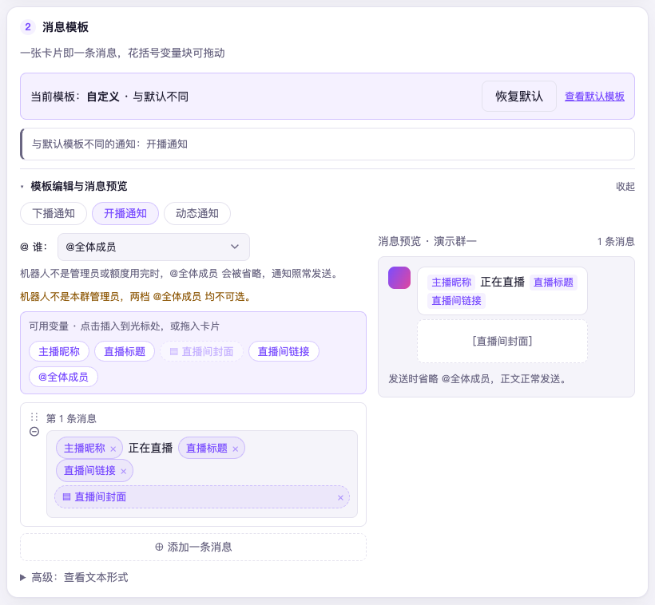

# 第 6 章　加主播、推到群

这一章办成一件事：主播开播、下播、发动态时，群里能收到消息。全程在控制台
「推送」页完成，不用碰任何文件。

推送页是两级结构：**主播 → 通道**。一位主播是一张卡；一个通道就是一个群或一位
好友——「这位主播的消息推到哪儿」。同一个群可以同时收好几位主播，同一位主播
也可以推给好几个群。

窗口宽于 900px 时，左边保留「主播 → 通道」树；900px 及以下改用页顶选择器，
通道写成「主播名 › 通道名」，同名群也能分清。左树顶部的「默认模板」选中时有底色。
主播页只列通道已开启的通知，其余显示「另 n 项未开」；全关时显示「全部停用」。
主播名旁的「看数据 →」可以打开场次和趋势。

## 加第一位主播

1. 推送页左树顶部点「**＋ 添加主播**」（900px 及以下在「选择主播或推送通道」选择器旁）
2. 在输入框里填 uid、直播间号，或直接粘贴个人空间、直播间的链接
   （形如 `https://space.bilibili.com/uid`）
3. 点「**查询**」。程序先把**昵称和头像**拉出来给你确认——uid 打错一位就配成了
   陌生人，这一步就是拦这个的
4. 确认是本人后点「**确认添加**」

加进来只是配好了「盯谁」，还没有人收到消息——得再给它配通道。

## 推给哪个群：通道

主播卡上点「**＋ 添加通道**」，会列出**机器人已经加入的群、已经加的好友**，
顶部有搜索框（搜群名、群号、好友昵称），名单分成「群 n 个」「好友 n 个」两组，
点目标右侧的「添加」按钮即可加入。已经是通道的目标放在各组末尾，标着「已添加」，不能重复添加。
已经在推别的主播的群，名单里会写出在推谁。同一个群推着几位主播时，每位主播的通道各管各的：
下播打赏播报的门槛、「通道规则」里的金额可见与静音时段、「群内命令」里的命令开关，都是每条通道一份。

> [!NOTE] 这里没有手填号码的格子，是故意的。群号手填错一位不会有任何报错，
> 消息只是发去了别处——而「配好了群里没动静」这类问题，排查起来全都长一个样。
> 从机器人自己的名单里挑，就填不错。

挑完直接进到这个通道的页面。页头写着主播、通道名与号，下面一行摘要：
开了几种通知、静音怎样、金额显不显示、命令几条可用，点哪一项就跳到对应那一块。往下依次是：

| 块 | 管什么 |
|---|---|
| 推送内容 | 每种通知一行，按一场直播的先后排：开播通知、下播通知、下播报告、下播打赏播报（见[下文](#下播打赏播报)）、动态通知、运营周报。每行一个开关，旁边直接写着这一种的现状（文字是自定义还是跟随默认、图片版式、播报门槛）；点「编辑」就在这一行里展开，改文字（下播报告只发图）、报告版式（见[第 9 章](09-stream-reports.md#调报告里放哪些块)）或门槛都在这里。没开的几种收在末尾「没开的 n 种」里，展开后拨开关就能开 |
| 通道规则 | 这位主播在这个群的金额可见与静音时段，默认摊开，见[第 7 章](07-manage-groups.md) |
| 群内命令 | 这位主播在这个群的命令开关，默认收起，见[第 7 章](07-manage-groups.md#命令开不开) |
| 本群状态 | @全体成员今天用了几次（只能看）、提醒订阅名单（点「管理名单」可移除订阅的人），以及「本群最近推送」：推到该群的所有主播最近几条推送成没成。好友通道这一块叫「该好友状态」，只有「该好友最近推送」 |
| 危险操作 | 「移除这个通道」 |

新加的通道默认普通通知全开、全用默认模板；运营周报默认关闭，需单独订阅。

「编辑」同时只展开一行：点了另一行，前一行就收起，改过的内容照样留着、等着一起保存。
下播报告的编辑只留〔图片版式〕；其他既有文字又有设置的通知，展开后分〔文字〕〔设置〕两个标签；
状态行写着默认还是自定义，改过了才出现「恢复默认」，只恢复这一种。展开着的那一行，
切到别的通道再回来仍摊着。

页面改的东西都要点右下角「**保存**」才存得下来——底部那条改动条数着还有几处没存；
点「放弃」则全部还原。下播报告的版式预览由 NovaBot 现场画，与真正发到群里的报告
出自同一段代码，调什么样群里就是什么样。

保存按主播分开存：两个人同时改不同的主播，互不影响。同时改同一位主播时，后保存的那一位会看到
「这位主播的配置刚被别人改过，请重新载入」和一枚「重新载入」按钮，处理办法见[第 15 章](15-members.md#两个人同时改了同一位主播怎么办)。

## 改消息的文字

下播报告一律只发图，通道和默认模板里以前存的文字保留，但不再起作用；图画不出来时发文字版报告。默认模板页不再显示下播报告的文字模板。

在「推送内容」里点其他通知的「编辑」（有两个标签的选〔文字〕），展开拼装台：左边一张张**消息卡**（一张卡将来就是一条
QQ 消息，多建一张卡就是多分一条），块上写中文名，像「主播昵称」，可以点、可以拖；
插件没起名的，照旧写花括号里的原名，存的还是原写法。
右边实时预览发到群里长什么样。常用的占位符：

| 占位符 | 用在 | 展开成 |
|---|---|---|
| `{uname}` | 带文字模板的通知 | 主播昵称 |
| `{title}` | 开播 | 直播间标题 |
| `{cover}` | 开播 | 直播间封面图 |
| `{url}` | 开播、下播、动态、下播打赏播报 | 跳转链接 |
| `{time}` | 下播 | 这一场播了多久 |
| `{action}` | 动态 | 动态动作，如「投稿了视频」 |
| `{picture}` | 动态、下播打赏播报 | 渲染出来的图片 |
| `{list}` | 下播打赏播报 | 这一阵够格的人，一人一段 |

「@ 谁」在「可用变量」上方单独一行的下拉里选择。开播、动态三选一：**@订阅者**（只 @ 发过「开播@我」这类命令的人，
见[第 7 章](07-manage-groups.md)）、**@全体成员**（机器人不是管理员或额度用完时
会被自动摘掉，通知照发）、**@全体成员，失败时改为 @订阅者**。
机器人不是本群管理员时，@全体成员 的选项变灰选不了；原先选着的照样显示，换走后要等机器人当上管理员才能再选。
好友通道里没有「@ 谁」这一行，也没有 @ 块：私聊里不 @ 人，原先存着的那一档不变。
说明在下拉旁直接显示。
@ 块在「可用变量」里，跟别的块一样：点一下插到光标处，或拖进卡里，可放到任意一条消息的任意位置。再次放置是挪位置，不会多出一个 @；切换提醒方式，已放好的块跟着变，
切到这类通知不支持的写法时，已放好的 @ 块会被拿掉。
Tab 到 @ 块后，左右方向键可挪位置，Delete 或退格键恢复默认位置。不放 @ 块时仍在第一条消息开头提醒。
开播、动态的旧模板打开时保留原文，只有主动编辑才调整。下播通知、下播报告、下播打赏播报不 @ 任何人，没有「@ 谁」这一行；下播报告忽略整份旧文字模板，存值保留。其他两类旧模板里放过的 @ 块不再生效，下次保存时去掉，原有提醒档位的存值不变。
确定机器人不是本群管理员时，页面说明 @全体成员 为什么选不了，预览显示省略提醒或改为提醒订阅成员的结果；
管理员名单取不到时不预判失败。

模板分两层：**默认模板**与**通道自己的**。通道页里直接就能改，改过任何一处，
这个通道就不再跟着默认走；左树顶部（900px 及以下在选择器旁）的「默认模板」改的是所有用默认的通道共享的
那一份——在那里改一次，跟着默认走的通道全部一起变。「默认模板使用情况」按通知列出用默认与自定义的数量，
点「查看名单」展开「主播名 › 通道名」。
默认模板有改动时才显示贴在底部的「保存默认模板」条，保存当前选中的通知；
「恢复出厂默认」文字链独立放在页底，确认后恢复当前通知。下播报告的图片版式在通道页调整。
默认模板里的「报告图配色」也能选择报告图的颜色，使用这一处自己的「保存报告图配色」按钮保存。
自定义了的通道不受默认模板影响，点「恢复默认」可以回到跟着走的状态。

> [!NOTE] 怎么改模板都不会把文字弄丢：一条消息里图片下载失败时，程序会自动
> 剥掉图片重发一次纯文字，日志里写明降级发生过。所以放心去拼，不必为了
> 「图挂了怎么办」留着千篇一律的默认。

## 运营周报

在推送页选择主播和通道，打开「运营周报」并保存，就为这位主播向这个群或好友订阅了周报。
每周一 **10:00（东八区）** 发送上一周的一张统计图加一句话摘要；图出不了时发文字版，
摘要和文字版开头都会带主播名；没有归档场次时只发「主播名 上周（统计期间）没有记录到开播。」。
统计周从周一早上 6 点到下周一早上 6 点，
一天从早上 6 点算起，凌晨的开播归在前一天。

遇静音时段，运营周报**顺延到静音结束后发送**，每五分钟复查一次；到下一周一 10:00
还没发出的那一期作废。停机错过发送时刻，启动后补最近一期一次，也遵守静音顺延。
周三才订阅的从下周一开始收。关闭全局推送开关、停用目标或取消订阅时不发送、不顺延。
已发出、发送失败或送达不明的周报不会自动重发；发送中途停机，重启后记为送达不明。
周报记录存不下时（推送页显示「自动发送已暂停」），周报暂停发送；恢复后，暂停前就订阅了的会话补发一次，
不会重复发送；暂停期间新勾选的会话，最晚从恢复后的下一期开始收（上面「周三才订阅的从下周一开始收」说的是平常运行时）。

金额按这条通道的「金额可见」设置：群默认隐藏，私聊默认显示；隐藏金额时图和文字都不显示金额。
「运营周报」开关下方的独立工具行显示上次状态，例如已发出、静音待发、发送失败、送达不明、
未发的原因或过期未发；从未有过记录时写「还没有发过」。

点这一行的「**编辑**」，在「**图片版式**」里选择数据卡片、拖动卡片顺序，开关每天柱图、本周观众、开播日历和本周场次。
右边直接预览这位主播上一个完整周的真实数据；改动版式或通道规则里的金额可见、配色后，预览跟着草稿更新。
上周没有记录到开播、画图失败或该平台没有周报图时，预览显示原有摘要与文字，不会填入示例数据。
点推送页「**保存**」后，周一定时发送与「发送上一周的报告」都按这条通道的版式画；「恢复默认」清除自定义版式，也要保存才生效。
关掉部分卡片后，其余卡片每行三张，后面的区块自动上移；全部关闭时仍保留页头、期间、开播说明与页脚，摘要文字照旧。
原来的「试发」现为「**发送上一周的报告**」。确认框列出上一个完整周的起止日期、目标群或好友，确认后会真实发送。与「发送测试消息」一样不受静音限制，不计入每周的发送记录，也不影响周一的定时发送。

「下播报告」那一行也有「**发送上一份下播报告**」。点开后先确认最近一场已下播直播的开播日期、时间和目标群或好友，再真实发送到当前这一条通道。没有已留明细的场次时提示「还没有可发的下播报告」，不会发送空图。
优先发这一场推送时留下的原图，逐字节相同，隔天或程序重启后也能补发。按此通道当前已保存的版式、金额可见和实际配色查找：之后改过外观，或这一场没推过这套外观时，有同一外观的原图就用，没有就按现在的设置从明细重画。原图已清理、损坏或当时没能存下时也会重画；重画不联网，封面、主播头像和榜单头像用占位图，不画粉丝增减和粉丝团数据。每位主播只留最近一场的原图，三十天没再被读到会自动清理。它不计作一次推送、不加首推提示、不受静音限制，也不影响下一场下播时的正常推送。

## 下播打赏播报

主播不在播的时候，也常有人上舰、送礼。「下播打赏播报」替主播在群里道一声谢。
名字里的「下播」通常说的是**不在播的这段时间**，这类打赏常在下播几小时后才来；
下播前最后 10 秒内的打赏还会在下播后另发一条提醒，同样按此通道的播报门槛筛选，上舰不受门槛限制。
提醒最多列出 20 人，其余人数汇总显示；金额可见时还带汇总金额。

- **谁够格**：这一阵里上了舰的（开通、续费都算，舰长、提督、总督都算），或者一个人
  送的礼物合计达到此通道的播报门槛。门槛跟着「这位主播推到这个群」的通道走，
  同一个群推了几位主播就各设各的；默认 **50 元**，**0 表示有打赏就播**，上舰不受门槛限制
- **在哪里改**：推送页选择主播和通道，打开「下播打赏播报」，点这一行的「编辑」、选〔设置〕，
  在「播报门槛（元）」里修改，再点「保存」；门槛不在「通道规则」里。这一行平时就写着当前门槛
- **什么时候发**：不当场发，先攒一阵。最后一份之后安静 1 分钟就发；一直有人送的话，
  从第一份算起最多攒 10 分钟也先发，之后来的算下一阵。一阵里一个够格的都没有就不发
- **不算的**：在播时收到的礼物和上舰（下播前最后 10 秒的另发提醒）、背包里送出的礼物和盲盒、醒目留言、银瓜子礼物。
  非背包盲盒计入礼物，按买盒子的实付金额合计
- **写不写金额**：跟这条通道「通道规则」里的「金额可见」走（见[第 7 章](07-manage-groups.md)）：
  隐藏时只写谁上了什么舰、送了哪些礼物各几个；显示时在上舰和每种礼物后面括号里带上金额，多种礼物另列合计
- **写不写时刻**：上舰和每种礼物前带赠送时刻，精确到分钟（东八区）；同一种礼物合并计数，
  跨多分钟时写起止时刻，跨天时带月日

默认发的是一张图：沿用下播报告的页头样式，页头是主播头像与名字、下面一行写这一阵
发出的时刻，正文逐人一段——谁上了什么舰（开通还是续费、舰长／提督／总督）、
送了哪些礼物各几个，上舰和每种礼物各一行。金额可见的群在明细后带金额，不可见的群一个金额都不画。
文字模板可用 `{list}`（一人一段）、`{uname}`、`{url}`，
也可用 `{picture}` 放图（与动态通知同名同义）；自定义模板按其中放的变量发送。
图一时画不出来时，`{picture}` 退回文字版，末尾注明图片绘制失败，这一阵的播报不会丢。

> [!NOTE] 攒着的那一阵只在内存里。程序在这一阵发出前重启，这一阵就不发了——
> 重启后再补一条旧闻没有意义。

## 不想推某类动态

主播发「直播回放」这类不想打扰群里的动态，用设置页的「**动态屏蔽词（全实例）**」：
每行一个词，动态的正文、标题或转发原文里含任何一个词就不推，保存后**立刻生效**，
不用重启。这一份管所有主播。

只想挡某一位主播的，在推送页点进这位主播，找到「**这位主播自己的屏蔽名单**」一块，
标签下方是整行输入框，在「动态屏蔽词」里每行填一个词，再点右下角「保存」，同样立刻生效。这里的词和设置页的全局词一起生效：
命中任何一份都不推；主播自己那份只能多挡，挡不掉全实例那份里的。

被挡下的动态会在日志页的时间线上留一条，写明命中了哪个词、是全实例的还是这位主播自己的——
「刚才那条为什么没推」有处可查。

## 只采集、不推送

配了主播、但一个通道都不加，就是一个**纯监听房间**：程序照常连接直播间、照常
累计数据，但一条 QQ 消息都不发。自建面板、只想留数据不想被消息打扰的场景用这个。

有一个前提：设置页的「仅连接已配置推送的直播间」要是关的（默认就是关）。手动开过它的
话，没有推送目标的主播会被整个跳过——表现正是「加了主播却什么都没发生」，
日志里会把跳过的房间逐个列出来，看一眼就知道是不是撞上了。

## 接下来

消息能进群了，接下来管群这一头：金额给谁看、命令开不开、谁会被 @，
见[第 7 章　管好每个群](07-manage-groups.md)。
