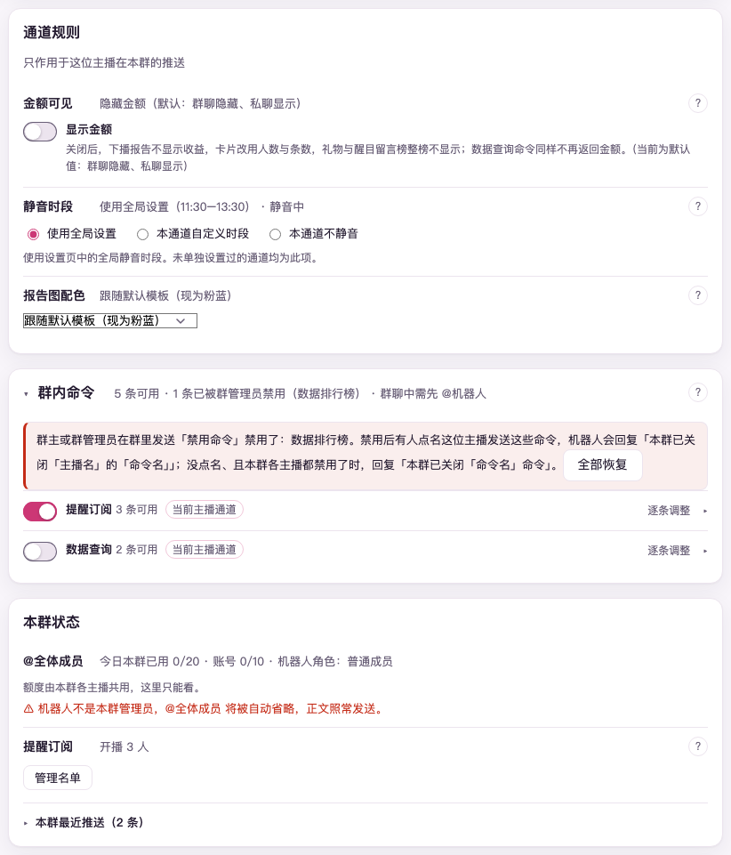

# 第 7 章　管好每个群

消息推到群里之后，群那一头还有几件事要管：金额给谁看、几点别吵、哪些命令开着、谁会被 @。
这些在推送页通道页的第 4 段「**通道设置**」里：点开一位主播推到这个群的通道，拉到最下面就是。

「通道设置」只管**这位主播推到这个群**这一条通道，段头写着「只作用于这位主播在本群的推送和命令」
（好友通道写「只作用于这位主播与该好友」）。金额可见、静音时段、命令开关这三样每条通道各一份：
一个群下面挂着三位主播时，三位可以各设各的；想三位一样，就到三条通道里各改一次。
下播打赏播报的门槛也按通道各设，但在第 3 段「下播打赏播报设置」里修改（见[第 6 章](06-add-streamer-and-push.md#下播打赏播报)）。

从旧版升级上来时，原来按群存的这三样，升级后第一次启动会照抄到这个群下的每一条通道，
群里看到的和升级前一样；之后再改，只改你打开的那一条。

「通道设置」默认折成几行摘要，点开哪行改哪行；展开过的行
切到别的通道再回来仍摊着。行末那颗「?」里是这行的详细说明，点一下看、再点一下
收起。和页面其它改动一样，按「保存」才存得下来，存完立刻生效、不用重启；按「放弃」全部还原。
这几样跟这位主播的推送配置存在一起，两个人同时改同一位主播时的处理见[第 15 章](15-members.md#两个人同时改了同一位主播怎么办)。

## 金额给谁看

「金额可见」这个开关管的是：这位主播的直播收益这类数字，在这个群显不显示。
同一个群里，可以一位主播显示、另一位隐藏。

它为什么不在报告版式里、而在通道设置里？因为金额不只在报告里出现——
「直播间数据」「数据排行榜 礼物」这些命令谁都能在群里打（见[第 8 章](08-commands-in-group.md)），
它们读不到报告的版式设置。只关报告里的金额，一句命令就全漏回来了。
放在通道这一层，这位主播在这个群的报告和命令一起管住：群里查哪位主播，就按哪位主播这条通道的设置回。

**默认私聊显示、群聊隐藏。** 在群里关掉（保持默认）之后：

- 流水那张卡只写「付费互动 N 人」，不带钱。醒目留言只写条数，盲盒只写个数，大航海只写次数
- 流水排行、醒目留言名单、盲盒盈亏榜**整段不出**；弹幕排行照常
- 「收到的礼物」整段不画；互动曲线照画，流水那条不标峰值
- 「本场开通大航海」名单照出；大航海全名单照常，本场开通或续费过的人名旁仍有「本场」
- 群里查数据的命令同样不回金额。查礼物榜、流水榜、醒目留言、盲盒盈亏会明说
  「本会话不展示金额相关的榜单」，并列出还能查哪些

流水排行和醒目留言名单是整段不出、而不是只抹掉数字：这两处的每一行，本质都是「某人花了多少钱」，
只去掉右侧的数字，仍然是在公开排消费。盲盒盈亏榜也一样：每一行都是某人盲盒赚了或亏了多少钱。

于是常见的用法不需要两套配置：「大群里只放词云和弹幕数，收益自己私聊看」——
同一份报告版式，推给哪个群就按那条通道的可见性画，私聊那边自己就是显示的。

## 静音时段

设置页里的静音时段管的是所有群和好友（见[第 10 章](10-quiet-and-alerts.md)）。
一个号常推好几个群：粉丝群想随时收到开播，工作群夜里不想被吵；同一个群里，
也可能想让一位主播夜里照发、另一位跟着静音——这一行就是给这种情况的，每条通道各设各的。
好友的通道里同样有这一行。

它有三档：

- **使用全局设置**：用设置页那一项。没动过的通道都是这一档
- **本通道自定义时段**：填开始、结束，格式是 `23:00` 这样的「时:分」，可以跨零点。
  起止不能填成一样：一样等于没设，保存时会被拒，提示里写着改选哪一档。
  要全天照发选「本通道不静音」，要跟设置页走选「使用全局设置」。
  这条通道只看自己这一对，不再看全局那一项
- **本通道不静音**：全局在静音时，这条通道照发

摘要行写着现在是哪一档、几点到几点；此刻这条通道正在静音时，后面带「静音中」（改了还没保存时先不带）。
和这一段别的几行一样，按「保存」才存，存完立刻生效，不用重启。

静音的规矩和全局那一项相同：这位主播的开播、下播、下播报告、动态、下播打赏播报，
到了这条通道的静音时段一律**直接丢掉，不攒着**，日志页时间线记一条「静音丢弃」。
运营周报除外：顺延到静音结束后发送。
同一场开播推好几个群时，只丢正在静音的那几条通道，其余照发。

群里命令的回复也照这个规矩，分两种：查某一位主播的（直播报告、直播间数据、数据排行榜、
开播@我 这类），按那位主播这条通道的静音时段；「菜单」「启用命令」「禁用命令」和第三方插件的命令不属于哪一位主播，
这个群里只要还有一条开着的通道不在静音，就照常回复。

有三件事不受这一行影响：设置页的「全局推送开关」关着时，哪一档都不发；
告警照常发出；连接页的「发送测试消息」照常发。首页顶上的静音提示条只看全局那一项。

## 命令开不开

「命令」这一行摊开后，列出能按主播分开关的那些命令（查数据、提醒订阅这几类），按类折成一叠：
每类一个总开关，点类名就摊开逐条拨，不必再找「细调」。每一类都标着「**当前主播通道**」——
拨一下只关这位主播在这个群的这几条，同一个群里别的主播不受影响。

有两种命令不在这一行里：

- 「菜单」（别名「帮助」「命令」）「启用命令」「禁用命令」：多主播的群里也一样关不掉——
  关了菜单，群里就再也没办法知道还能用什么；关了启用命令，关掉的东西就开不回来了。
  群里有人发「禁用命令 菜单」，机器人回「「菜单」不可开关」
- 第三方插件加的命令：仍按群，一个群一份，不分主播。要关，在群里发「禁用命令 ××」

群管理员也可以直接在群里关命令（发「禁用命令 ××」，见[第 8 章](08-commands-in-group.md)），
在群里关掉的同样记在各条通道上，立即生效。这条通道关着的命令会列成一条红字，
带一枚「全部恢复」；恢复之后，群管理员仍然可以再关。改过名、已删除的命令残留下的旧禁用记录也会显示出来，
标明「保留也不会生效」，可以「清除记录」。

回到主播那一页，「推送通道」里每个通道一行，关了命令的那一行带「已禁用 N 条命令」：
N 是这条通道关掉的，加上这个群关掉的第三方插件命令。

推送页上如果出现一块「未配置推送但仍有状态记录的会话」，那是曾经配过、
后来从通道里删掉的群或好友。这里只列还留着的第三方插件命令开关和提醒订阅，可以点「恢复这些命令」；
重新配上推送后，它们照旧生效。金额、静音和按主播的命令开关的旧记录只留着备退回旧版用。

## 提醒订阅：谁开播时会被 @

群成员自己发「开播@我」「动态@我」订阅提醒（[第 8 章](08-commands-in-group.md)），
订过的人都记在这里：「提醒订阅」一行显示这位主播在这个群积了多少人，开播、动态分开数，
点「管理名单」可以移除某一个人，或「清空」整份名单——清空在保存前
还会再确认一次，点错了还能撤回。

人退群后订阅仍然留着，@ 一个不在群里的号是无效的，这里正是清理的地方。
注意「谁会被 @」不在这里设——那是在通道的消息模板里 @ 那一档选的
（见[第 6 章](06-add-streamer-and-push.md)）。

## @全体成员

最后一行是状态、不是开关，标着「本群各主播共用」：今日本群已用几次、机器人账号今日已用几次、
机器人在这群里是不是管理员。不是管理员时它会写明：**@全体成员 会被自动摘掉，
正文照发**——「配了 @全体成员 却没 @ 到人」这件事，提前在这里说清了。

## 接下来

群成员自己能做什么？机器人听不懂的怎么问？见[第 8 章　群里怎么用命令](08-commands-in-group.md)。
