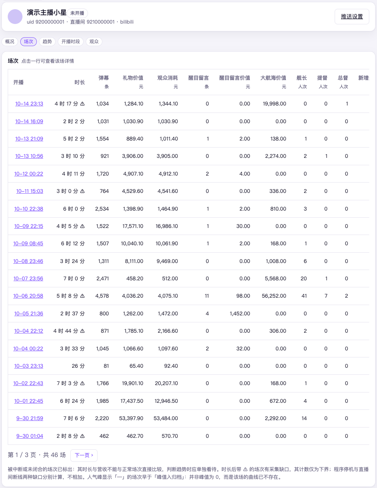
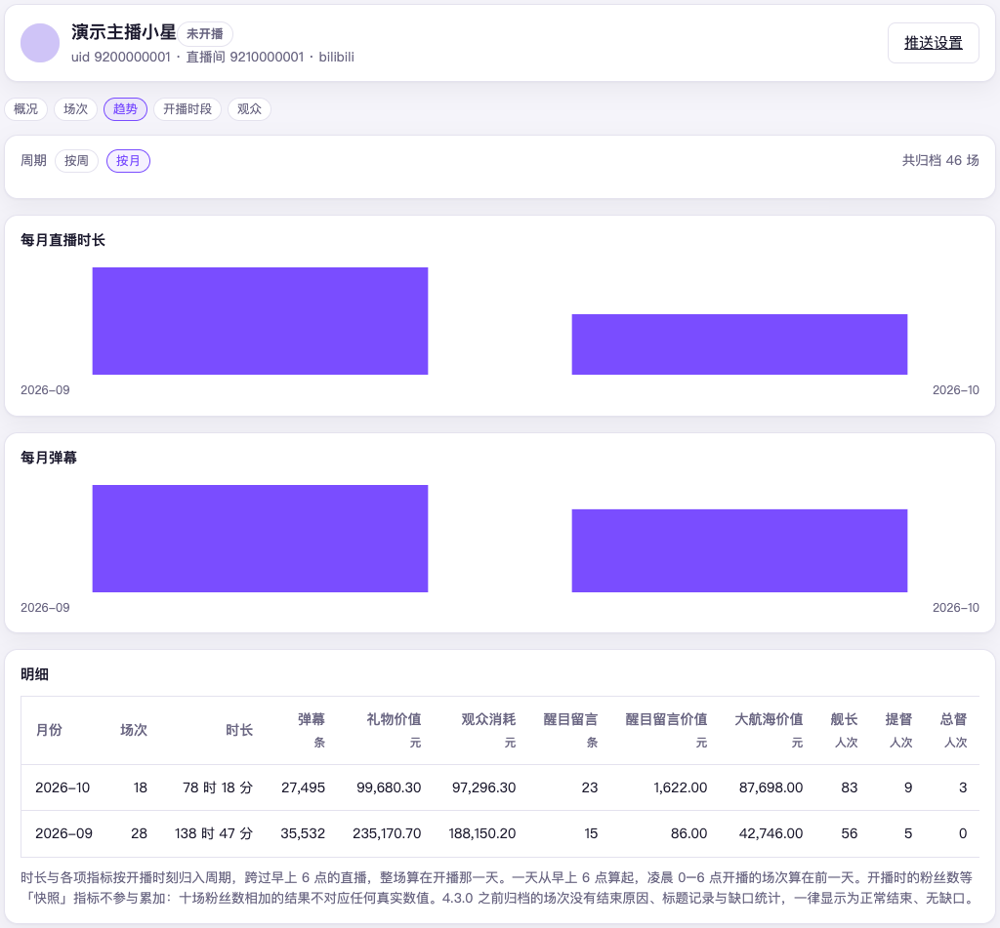

# 第 9 章　看播得怎么样

每场直播结束，NovaBot 会把这一场记下来，并画一张下播报告图。
想回头看某一场、或者看这个月比上个月播得怎么样，去控制台的「主播」页。
想改群里收到的那张报告图长什么样，去「推送」页。

## 在主播页看直播数据

主播列表显示近 7 天的场次与时长。一天从早上 6 点算起，凌晨 0–6 点开播的场次算在前一天。

打开「主播」页，点主播列表的整行就能进入详情，上面有五个页签：

- **概况**：近一段时间播了多少、收入和观众怎么样
- **场次**：每一场一行，点哪一行就看哪一场的报告
- **趋势**：把场次按周或按月聚起来看
- **开播时段**：看星期几、几点开播的场次表现较好
- **观众**：看这段时间来过哪些人、来过几场、有没有互动

在播时，「概况」里的「正在直播」显示当前这一场的数据；停在概况且页面可见时，每 15 秒刷新一次，也可以点「刷新」手动更新。

这些数字只在控制台里看得到，不会发到群里。

### 概况：近 7／30／90 天

概况最上面可以切换「近 7 天」「近 30 天」「近 90 天」，默认近 30 天；选中的范围会保留在地址中，刷新或后退时仍能恢复。范围包含今天，一天从东八区早上 6 点算起，凌晨 0–6 点开播的场次归入前一天，整场按开播时刻归入。正在直播的这一场下播后才计入。

- **直播时长**：范围内各场时长相加，下方显示共几场。
- **流水**：礼物价值、醒目留言价值与大航海价值之和，单位为元，与下播报告一致。
- **弹幕**：各场弹幕条数相加。
- **观众**：各场观众名单合并去重，同一观众来过多场也只算一人。
- **互动观众**：发过弹幕、点过赞、送过礼物、发过醒目留言、开过盲盒或上过舰的去重人数，不含只进过直播间的人。
- **粉丝净增**：范围结束前最近一次粉丝快照减去范围开始前最近一次快照。开始前没有快照时，从范围内最早一次起算；不足两次可用快照时显示「暂无数据」。悬停可查看实际使用的两次采样时刻与人数。

统计格下方的**「较上期」**，是把本期的起止时刻一起往前挪所选的天数，再比涨跌。选近 7 天就前移 7 天，选近 30／90 天就前移 30／90 天；今天还没过完，上期也只算到对应钟点。直播时长、流水、弹幕、观众、互动观众这五格会比，**粉丝净增不比**。涨幅用红色，跌幅用绿色；变化不到 0.5% 时写「较上期持平」，不上色，其他涨跌百分比四舍五入到整数。

某格没有「较上期」，表示这项暂时不能比。原因包括：上期没有开播、本期或上期少于 2 场、平台没有这项统计、上期这项为 0；观众与互动观众还会因为本期或上期有场次没有名单而不比。

有未比较的项目或名单提醒时，下方会出现默认收起的**「对比说明 · N 项未比较」**。点开能看到上面这些原因，以及各自影响了哪几格；同一个原因会放在一起。如果本期或上期有升级到 6.0 之前开播、名单完整性未知的场次，还会提醒「观众数对比仅供参考」；这条提醒本身不会阻止比较，所以也可能写着「0 项未比较」。

「本期首次记录」是范围内来过、此前从未出现在这位主播归档名单中的观众；「回访」是此前也出现过的观众。两者相加等于本期观众人数。首次记录只表示 NovaBot 第一次记到这位观众，不一定是第一次来看直播。范围开始前没有带名单的场次时，构成显示「暂无数据」，悬停说明名单从何时开始记录；从未记录过带名单的场次时，悬停写「尚未记录到带名单的场次」。

这段时间没有带名单的场次时，观众、互动观众与本期构成都显示「暂无数据」。

名单说明只列出非零项：「完整」表示没有认不出的观众；「含无法识别的观众」表示这些场次的人数偏少；「完整性未知」表示升级到 6.0 之前开播时还没有记录这一项；「没有名单」表示这些场次不能参与观众去重。观众与互动观众只用带名单的场次计算，范围内全无名单时显示「暂无数据」，不会当成 0。

下方可切换时长、流水、弹幕或观众的按天走势，默认流水。每天的观众也按当天各场名单去重。没有记录到开播的日子不画柱，悬停提示「当天没有开播记录」；有场次且数值为 0 的日子保留零值柱，悬停可看日期、数值与场次数。没有平台统计口径时，这张卡只展示场次、时长与时长走势。

### 场次：一场一行

每行是开播时刻、时长、这一场的各项数字、标题和结束原因。
标题改过的，后面会注明「（修改过 N 次）」。主播打开设置又原样保存时，平台也会发一条通知，内容没变的不算一次改动。

点一行就打开「单场报告」。报告图每次都按那一场存下的数据当场重画，
所以要稍等一下；早年的场次如果没留下明细数据，会直接告诉你画不出来。

有两种标记要留意：

- **时长后面带 ⚠**：这一场有采集缺口。程序停过（维护、重启）或者直播间连接断过，
  那段时间里的弹幕和礼物没人接收，**事后也补不回来**。鼠标停在时长上能看到缺了多久，
  这一行的每个数字都只是「至少这么多」。
- **结束原因不是「正常」**：可能是「被平台切断」「直播间被封禁」或「异常中断未闭合」，
  这几种行会变灰。「异常中断未闭合」是程序在这一场进行中退出了、没看到结尾，
  结束时刻只能取最后一次存盘的时刻，时长同样只是下界。

这几类场次的时长和收入跟正常场次**不可比**，看趋势时单独看待。

### 趋势：按周、按月

一天从早上 6 点算起，凌晨 0–6 点开播的场次算在前一天。

在「趋势」页签选「按周」或「按月」，上面是每周（或每月）的直播时长图，
下面是明细表。读之前先知道这几件事，不然容易把数字读歪：

- **整场算在开播那一天。** 跨过早上 6 点的直播，整场算在开播那一天：周一凌晨 5 点开播、7 点下播的那场，
  整场算在周日（也就算在周日那一周），不会拆成两半。
- **中间没播的周、月也会列出来。** 空着的那一格本身就说明问题，跳过它会让趋势看着更连贯。
- **加起来的是人次，不是人数。** 每场只存了「多少人」，没存「是谁」。
  同一个人三场都发过弹幕，周合计里算三次。表上不写「人次」两个字，这个数也只能这么读。
- **粉丝数、粉丝团人数、大航海人数不累加。** 它们记的是开播那一刻有多少，
  十场加起来既不是月初也不是月末的数字，所以趋势里不算。
- **在线人数和高能用户也不进周、月。** 每场留下的是那一场的峰值，
  几场峰值加起来既不是同时在线人数，也不是人次。
- **较老版本记下的场次没有缺口统计**，一律显示成无缺口——那是当年没在算，不是真一秒没漏。

### 开播时段：看什么时候开播表现好

在「开播时段」页签选**「近 90 天」或「近 180 天」**，默认近 90 天。点「每小时流水」或「每小时弹幕」切换，默认看流水，上面的推荐和下面的表会一起换。

表的行是周一到周日，列是开播钟点，每两小时一格。按东八区的实际星期与钟表时间归入，周一凌晨开播就放在周一，不按早上 6 点换日。每格的数是**这些场次的整场流水或弹幕总量，除以有效直播时长**，折成每小时；有效时长会扣掉维护、重启和断流的采集缺口。它不是只算那两小时里的产出，也不是先算每场再取平均。

每格下面写有几场。**少于 3 场显示「样本不足」**，没有场次显示「—」和「0 场」；够 3 场但没有可用的统计，或有效时长为 0，显示「暂无数据」。有数值的格子里，每小时流水或弹幕越高，颜色越深；没有数值的格子不参与深浅比较。

上面的**「表现较好的开播时段」最多三行**：只从至少 3 场、有效时长大于 0 且有当前这项统计的格子里挑，按每小时数值从高到低排。数值相同，先选场次多的；再相同，按周一到周日、从早到晚排。够几个就列几个，没有可选的格子时显示「当前范围暂无达到 3 场的时段」。

点一格，下方列出这个时段的场次、开播时间、时长和整场流水或弹幕；点开播时间进入单场报告。手机上表格可以**左右滑动**。

### 观众：看这段时间谁来过

在「观众」页签选**「近 7 天」「近 30 天」「近 90 天」**，范围的取法与[概况](#概况：近-7／30／90-天)相同。

四个分组是**本期全部观众、本期首次记录、回访、本期互动观众**，旁边带各组人数；无法判断时显示「暂无数据」。观众、互动观众和首次记录、回访的定义，见上面「概况」里的六格说明与首次记录、回访的定义段落。

表里一人一行，共五列：

- **昵称**：记录到的名字，没记到时写「未记录昵称」。
- **本期到场**：本期名单里出现过几场，同一场只算一次。
- **最近到场**：最近来过的那场的开播日期；下方小字「首次」是已有记录中第一次出现的那场的开播日期，不只看本期。
- **本期流水（元）**：这个人本期的礼物、醒目留言与大航海金额合计。
- **本期互动**：本期是否有过互动，写「有」或「无」。

**本期流水里的「—」表示金额不全，不能当成 0。** 只要这个人本期来过的场次里有一场缺少逐人金额，就会这样显示。

点**「本期到场」「本期流水」「最近到场」**的列名可以排序：前两列从多到少，最近到场从近到远，默认按本期到场排；再点同一列不会倒过来。按流水排时，「—」放在有金额的人后面。每页 **20 人**，底部可翻上一页、下一页。

点昵称，展开这个人本期来过的场次，列出开播时间与标题；点其中一场进入单场报告。

分组下方的「名单：完整 N 场；完整性未知 M 场」说的是**本期场次的名单情况，不是人数**，只列非零项。「完整」表示没有认不出的观众，「完整性未知」表示升级到 6.0 之前开播时还没有记录这一项；其他情况见上面的名单说明。

切到别的页签再回来，选的**范围、分组、排序、页码都会保留**；这些选择也记在地址里，刷新页面仍能恢复。换范围、换分组或换排序时，会回到第 1 页。

## 下播报告版式

下播报告是一张长图，从上到下大致是：

1. 直播间封面横幅
2. 一行概况：直播时长。有采集缺口时写在时长后面。这一行不再写赚了多少
3. 数据卡片。第一格是「流水」：礼物（主播到手的价值，含背包礼物和盲盒开出的礼物，不含免费礼物）、醒目留言、大航海加在一起，
   下面写本场付过钱的人数。大航海那张写「+N 次」，分得清时再写「新开 a · 续费 b」。盲盒那张大字写本场盲盒盈亏（如「-¥18.4」），
   下面写「盲盒盈亏 · N 个」；不显示金额时只写开了几个。没有单独的礼物卡
4. 本场变化：粉丝、粉丝团涨了多少。大航海写「在舰 X 人」，旁边是「较开播 ±Y」。这是此刻还在舰上的人数，和上面那张「+N 次」不是同一个数
5. 互动曲线：弹幕、流水、看过人数、在线人数，各画一条。礼物、醒目留言、盲盒、大航海不再分开画
6. 高能时刻：弹幕最密集的几个时段
7. 收到的礼物：最上面是总督、提督、舰长，只出本场有人开的档，写次数，一律排在礼物前面。下面是礼物，贵的排前面
8. 排行和名单：弹幕排行；流水排行（每人的礼物、醒目留言、上舰加在一起）；
   醒目留言名单（每人一行：昵称、合计金额、几条，下面带原文）；盲盒盈亏榜（每人本场盲盒赚了或亏了多少，赚得多的在前；亏的那几行条是绿色）
9. 大航海全名单。人数超过「全名单人数」时只列前几名，标题写「大航海名单（前 N 名）」。本场开通或续费过的人名旁有「本场」。另一份「本场开通大航海」名单只在不显示金额时出
10. 弹幕词云

哪一块数字为零就不画，冷清的场次报告会自动变短，不留空洞。

图上可能出现两行提示：

- **「采集缺口 共 X 分 X 秒」**，跟在直播时长后面，括号里分列维护、重启、断流各占多少。
  意思同主播页的 ⚠：这一场有一段没收到数据。
- **「有 N 条推送的图片未送达」**：这一场有推送的图片没发出去，但文字发到了。
  为零时不显示，看不到这一行就是都送到了。

互动曲线有四条：弹幕、流水、看过人数、在线人数，各按自己的峰值来画。
没采到数据的那几分钟画成斜纹，不是一条贴着底的面积。
真没人说话的几分钟才是贴着底线的细面积：斜纹是「这段没有数」，细面积是「这段是零」。
不显示金额时，四条照画，流水那条不标峰值。

### 两条人数曲线怎么读

- **看过人数**：这一场累计来过多少人，只涨不跌。它的**斜率**才有信息量——
  哪段时间在涨人，哪段时间没人进来。
- **在线人数**：此刻有多少登录观众在看，会涨也会跌，是哔哩哔哩高能榜那个口径。

两条不是一回事，别拿看过人数当同时在线人数。

### 高能时刻

列出弹幕最密集的几个时段，写的是**距开播多久**，也就是回看录播时要拖到的位置，
方便剪切片。它只挑真高峰：那一分钟要明显高于本场平常的密度、本身也要够热闹，
最多挑三个、彼此隔开几分钟。冷场不会硬凑出三个「高能时刻」，那一段干脆不出现。

它只看弹幕数，不看金额。

## 调报告里放哪些块

报告图的版式**按推送目标分别设**：同一位主播推给两个群，可以一个群给完整版、
另一个群只给简版。

1. 打开「推送」页，找到这位主播和要改的那个群
2. 通道页第 3 段「下播报告版式」（「推送类型」里开着下播报告才有这一段），左边是开关和数字框，右边是发到群里的样子
3. 这一段直接就能改；改过之后状态行由「当前版式：默认」变为「当前版式：自定义」，旁边出现「恢复默认」
4. 改完按页面底部的「保存」

想退回默认，点「恢复默认」。退回之后，默认版式以后再变，这个群也跟着变。

能调的项：

| 项 | 默认 | 说明 |
|---|---|---|
| 直播间封面 | 开 | 顶上的封面横幅 |
| 数据卡片 | 开 | 弹幕、流水、点赞等概览卡片，下面十张可以各自拿掉、调先后（见表下） |
| 本场变化 | 开 | 粉丝、粉丝团与大航海人数的涨幅；每出一张报告要多查三次平台接口，在意请求次数可以关掉 |
| 互动曲线 | 开 | 弹幕、流水等随时间的变化 |
| 本场开通大航海名单 | 开 | 本场开通大航海的观众。只在不显示金额的会话里画；显示金额时不画这张，全名单上的「本场」小标已经标出同一批人 |
| 大航海全名单 | 开 | 这位主播当前的全部大航海，不只本场新开通的。拉不到时会写明，不会让整张报告失败 |
| 全名单人数 | 30 | 展示前几名，0 为不限。人数超过它时，名单标题写「前 N 名」 |
| 弹幕词云 | 开 | 本场弹幕的词云 |
| 高能时刻 | 开 | 弹幕最密集的几个时段，对应可剪切片的时间点 |
| 礼物列表 | 开 | 本场收到的礼物与大航海，按种类列出个数 |
| 弹幕排行 | 5 | 展示前几名，0 为不展示 |
| 流水排行 | 5 | 每人礼物、醒目留言与上舰的金额合计。展示前几名，0 为不展示 |
| 醒目留言名单 | 10 | 发过醒目留言的观众，每人一行、带原文。展示前几人，0 为不展示 |
| 盲盒盈亏榜 | 0 | 每人本场盲盒盈亏多少，赚得多的在前。展示前几名，0 为不展示 |

排行和名单填的都是「展示前几名」，醒目留言名单是前几人，填 0 就不展示。
一个数同时管开关和长度。填得太大或是负数，会被拉回到能画的范围里，不会把图画坏。

「数据卡片」下面是十张卡的小块，默认全在报告里，可以只给某个群留几张，也可以调先后：
流水、弹幕、点赞、进入直播间、新增关注、醒目留言、大航海、盲盒、免费礼物、分享。

- 上面「已启用卡片」一区，从左往右就是图上的先后。把一块拖到另一块的前面或后面，就换到那里。
  图上照这个顺序从左到右、从上到下排，每行三张。
- 全部卡片都在报告里时，下面不显示备选区。不要哪张，点它上面的 ×，备选区出现，列出「未启用卡片」。
  区域标题保留「点击或拖回上方即可启用」；最后一张放回后，备选区收起。
- 想放回来，点一下下面那块，它排到报告区末尾；也可以把它拖进报告区，放在想要的位置。
- 不用鼠标也行：Tab 走到小块上，左右方向键挪一格，Delete 或退格键拿掉；
  在下面那区的小块上按回车或空格放回。手机上拖不动，点 × 拿掉、点一下放回都能用。
- 鼠标停在小块上能看到这张卡画什么。带 ¥ 的几张（流水、醒目留言、大航海、盲盒）
  在隐藏金额的会话里换成不带钱的说法。
- 报告区里的卡照旧为 0 不画，后面的往前补；弹幕一张在报告区里时 0 条也画，拿掉才不画。
- 「数据卡片」总开关关着时，这两区不起作用，灰掉锁住，存着的设定不动，打开就亮回来。
- 一张都不剩（全拿掉了，或报告区里的这场都是 0）时，卡片这一块整块不画，不留空白。
- 「恢复默认」把十张放回报告区、顺序回到默认；拿掉了哪张、只调了顺序，都算自定义版式。
- 以前存的版式里没有这些开关和顺序，十张按开着算、流水排第一，报告和以前一样。
  存着的顺序里缺了哪张卡（比如以后新加的卡），按默认顺序补在后面，不会因此不画。
- 群里的「直播报告」命令在这个群没配下播报告推送时、以及重画旧报告时，十张都照画，按默认顺序。

有几项跟着这个群能不能看到金额走（金额给谁看在第 7 章）：本群设置里隐藏金额时，礼物列表、
流水排行、醒目留言名单与盲盒盈亏榜在图上不画，在左边灰掉并写明原因；反过来显示金额时，灰掉的是
「本场开通大航海名单」。灰掉的项存着的值不动，到「本群设置」把「金额可见」拨过去就亮回来，
拨了还没保存这边也当场跟着变。数据卡片与互动曲线不灰——隐藏金额时它们照画，
只是换成不带金额的说法，旁边有一句说明。

### 不想让群里看到金额

版式管的是「图上放什么」，**谁能看到钱**是另一件事，在「推送」页通道的「本群设置」里按群管，
群里默认不显示金额。关掉后报告里哪几块不画、哪几块照画，见[第 7 章](07-manage-groups.md#金额给谁看)；
高能时刻只看弹幕数，不受影响。

### 图上打自己的标

想在图的底部打自己的标，打开设置页搜「标识」：

- **报告自定义标识图片**：下播报告底部。填本机一张图片的路径，留空就不画
- **动态自定义标识图片**：动态那张图的底部，单独一项

两项互不相干。想打同一个标，就填同一个路径。图片按固定高度缩放，画在署名之上。改完要重启。

## 词云不计某些人

直播间里常有欢迎机器人、感谢机器人刷屏，它们的「欢迎」「感谢」会把词云占满。
可以让词云不计这些人的弹幕：

1. 打开设置页，搜「词云」
2. 在「词云排除的用户」里填对方的**哔哩哔哩用户编号**（个人空间地址里那串数字），每行一个
3. 保存，**立刻生效**，不用重启

要知道的几点：

- **只认编号，不认昵称。** 填昵称或带字母的行会被跳过。
- **只影响词云。** 弹幕排行、弹幕条数照常算这些人。
- **弹幕原文照常保存**，名单删掉后词云就又算回来。
- 在主播页重画以前的场次时，也按现在的名单算词云。
  个别老场次没留下弹幕原文的，词云只能按当时存的样子画，名单对它不起作用。

不想让某些词上词云，就在旁边的「词云屏蔽词」里每行填一个词：凡是包含这个词的词都不出现
（填「哈哈」，「哈哈哈」也不出现），英文不分大小写；保存立刻生效，重画以前的场次也按现在的这张表。

## 接下来

报告能看了，下一件事是别让它半夜吵到人，以及出了事能第一时间知道：
[第 10 章　别被半夜吵醒、出事有人告诉你](10-quiet-and-alerts.md)。
