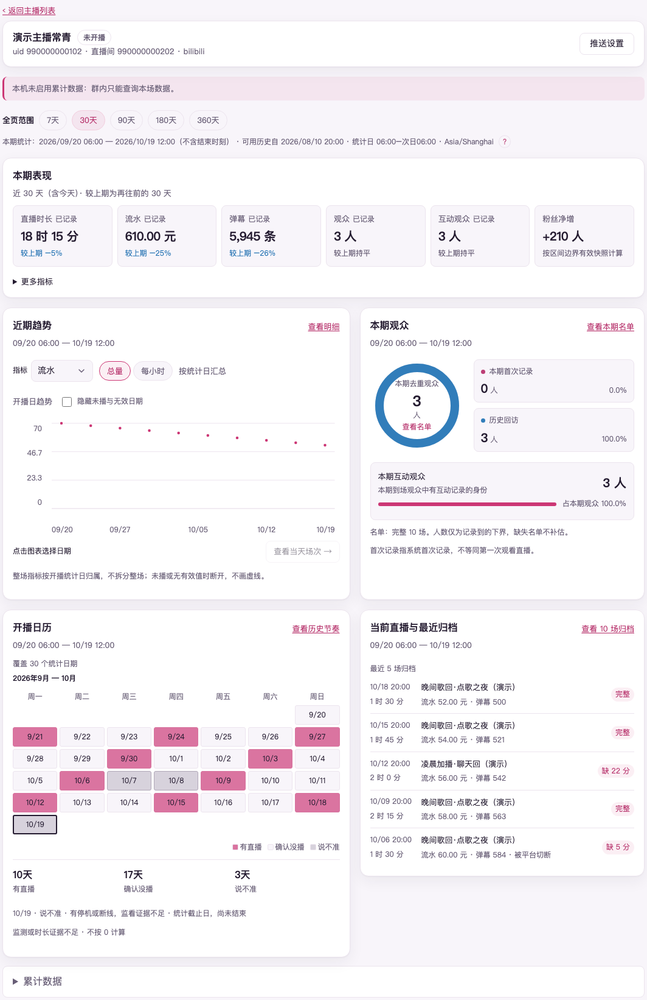
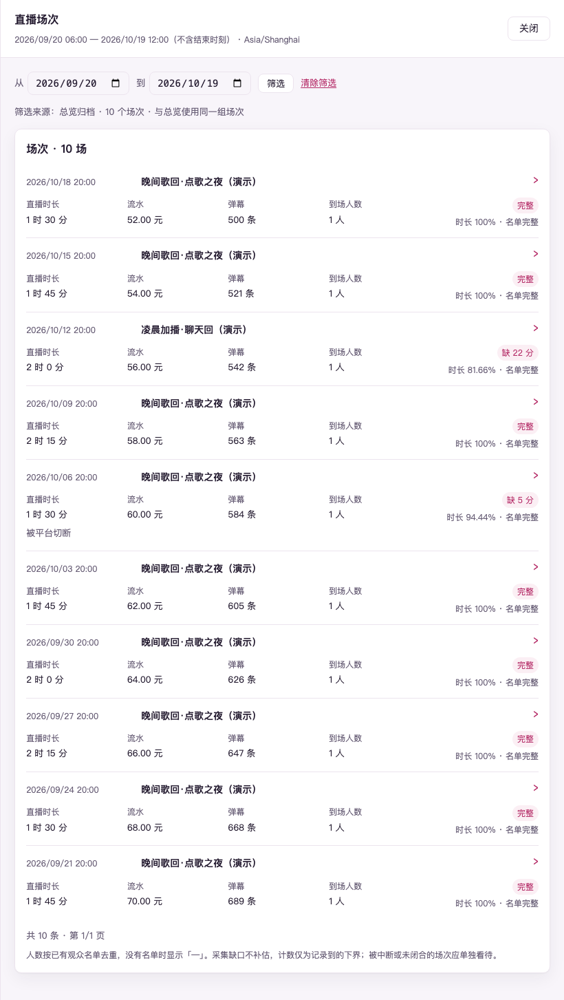
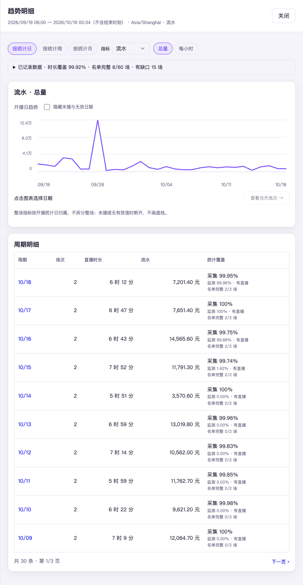
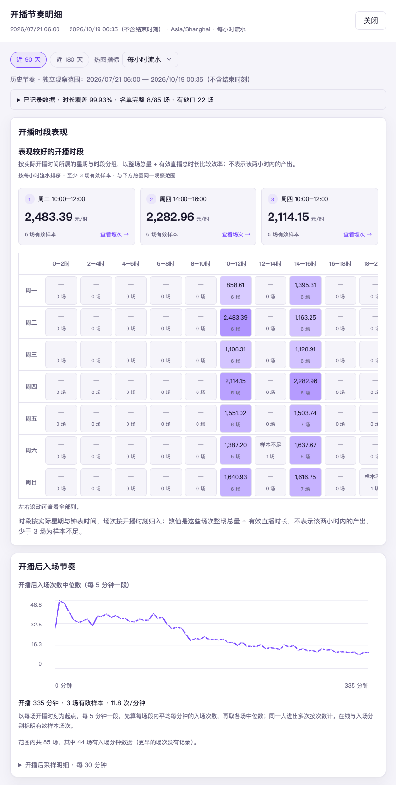
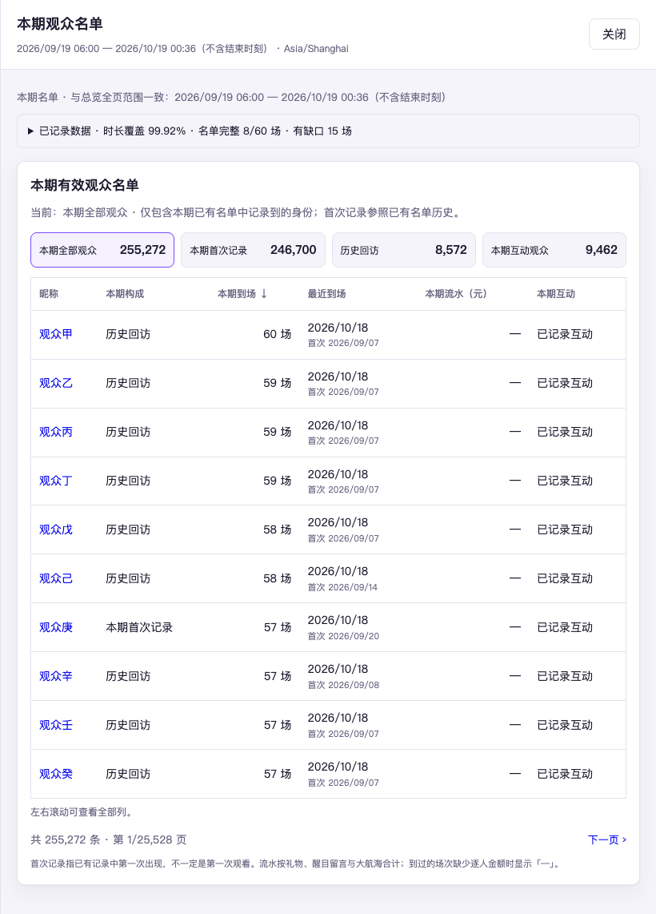
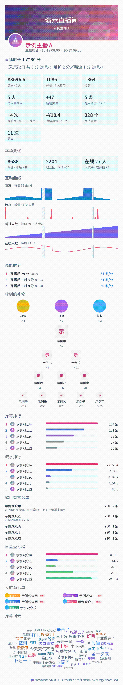

# 第 9 章　看播得怎么样

每场直播结束，NovaBot 会把这一场记下来，并画一张下播报告图。
想回头看某一场、或者看这个月比上个月播得怎么样，去控制台的「主播」页。
想改群里收到的那张报告图长什么样，去「推送」页。

## 在主播页看直播数据

主播列表显示近 7 天的场次与时长。一天从早上 6 点算起，凌晨 0–6 点开播的场次算在前一天。
列表分「启用主播」「停用主播」两组；页顶的「在册主播（含停用）」把停用的也数进去，场次与时长只汇总启用主播。
停用主播的历史场次照样能点进去看。每行先显示场次、时长和最近一场，uid 与直播间号放在末尾；右侧「›」可进入详情。小折线只画到昨天，旁边的场次合计仍含今天已归档的场次。

打开「主播」页，点主播列表的整行，就进入这位主播的一页总览。明细从右侧抽屉打开，头部有标题、范围小字，右上点「关闭」回到总览。

这些数字只在控制台里看得到，不会发到群里。

### 总览

页顶是「‹ 返回主播列表」和主播头卡：头像、名字、开播状态，下面是 uid、直播间号与平台，右侧「推送设置」可去改推送。

没有配置累计数据，或累计数据暂时不可用时，会出现灰条「本机未启用累计数据：群内只能查询本场数据。」；只影响群里带「总」的查法，这一页的数字照常。开启方法见[第 8 章](08-commands-in-group.md)的累计数据说明。

范围按钮下用一行小字合并本期起止、可用历史起点与「统计日 06:00–次日06:00 · Asia/Shanghai」。页上时刻一律按东八区，手机上这行会自动换行。

**先选「全页范围」**：7天／30天／90天／180天／360天，默认 30天。下方「本期统计」写出实际起止，结束时刻不计入。范围含今天；场次与整场指标按开播统计日归入，跨日也不拆开，正在直播的这一场下播后才归档。

点小字旁的「?」展开统计口径，可看「全页范围」「对比范围」、归档与完整名单场数及统计说明。读取失败时，范围会注明原因。

**「本期表现」有六格**：

- **直播时长**：本期归档场次的时长合计。
- **流水**：礼物、醒目留言与大航海金额合计，单位为元。
- **弹幕**：本期归档场次的弹幕条数合计。
- **观众**：已有名单合并去重，同一人来多场只算一人。
- **互动观众**：有弹幕、点赞、礼物、醒目留言、盲盒或上舰等互动记录的去重人数，不含只进过直播间的人。
- **粉丝净增**：按区间边界有效快照计算；快照未覆盖整个范围时会注明从何时起算，不足两次时显示「暂无数据」。点这一格打开「粉丝变化」抽屉，看所选范围的粉丝数曲线与快照说明。纵轴随实际数据范围缩放，人数刻度取整数；下方「每日净增」表比较相邻统计日的末次有效快照，首日或缺少前一天快照时显示「—」，不补估缺失日期。

前五格在监测、采集或名单不全时会带「已记录」，表示只数记到的数据，不补估缺失部分。能比较时，下面有「较上期」的涨跌或持平，涨跌使用专用颜色；上期是起止一起再往前挪所选天数的一段。不能比较的原因可展开卡上的对比说明查看。粉丝净增不比上期。卡下「更多指标」展开可看场次、新增关注、每小时流水、每小时弹幕。

接着是四张卡，宽屏下分两列：

- **近期趋势**：选指标；流水、弹幕、新增关注还可切「总量／每小时」。折线按统计日画，可勾「隐藏未播与无效日期」；点图选中日期，再点「查看当天场次 →」。未播或无有效值处断开，不补零。
- **本期观众**：圆环是本期去重观众，大人数缩写为万或亿，「人」放在数字下方；悬停数字可看完整人数。旁边分「本期首次记录」「历史回访」，下方是本期互动观众及占比。首次记录指系统里第一次记录到，不等于第一次观看直播；历史回访是此前也有记录的人。缺失名单不补估，历史名单不足时构成会显示暂无数据。
- **开播日历**：日期按「有直播／确认没播／说不准」标色，下方分别合计天数。点一天可看有效时长（扣掉采集缺口）、缺口和覆盖率，再点「查看 M/D 场次」。说不准表示证据不足，不能当成没播。
- **当前直播与最近归档**：在播时上面显示本场直播卡；停在这位已配置主播的页面、页面可见且资料已读到时，每 15 秒检查一次当前直播，也可点「刷新」。整页重取失败会保留资料并继续定时检查，下次重取成功清除页脚失败提示。卡片按内容高度显示。隐藏页面或离开后暂停，回到可见页面会立即检查；未播时也会检查是否开播。下方未播时最多列最近 5 场归档，在播时最多 3 场，每行有开播时刻、标题、时长、流水、弹幕，以及「完整」或「缺 N 秒」等徽章。

最下面「累计数据」默认收着，展开有「累计」和「基础数据」两块。

### 直播场次

点「当前直播与最近归档」右上「查看 N 场归档」，打开「直播场次」抽屉，初始与总览使用同一组归档。上面可填「从／到」日期，点「筛选」；日期也按早上 6 点换日，「到」包含所选统计日。「清除筛选」回到全部归档。

「筛选来源」会写明来自总览归档、开播日历、近期趋势、开播节奏或分区对比，并写出场次数。从日历的一天、趋势的一天或周期、热图的一格、分区对比的一行进入时，只列相关场次；日历还会列出跨 06:00、与所选统计日重叠的归档。

「场次 · N 场」里每块有日期、标题，下面是直播时长／流水／弹幕／到场人数。右侧徽章表示是否记到采集缺口，「时长 N%」是有效时长占比，旁边另写名单完整、含匿名、完整性未知或无名单。**「完整」只表示未记录到采集缺口，不保证名单完整。** 每页 10 条，底部有「共 N 条 · 第 1/M 页」和翻页链接。

流水没有指标快照时显示「—」，有快照且没有收入时显示 0.00 元。「—」不能当成零。人数按已有名单去重，没有名单时也显示「—」。缺口不补估，这些数字只是记录到的下界。

**中断场次的结束原因**写在最近归档那一行的数字后面，也写在「直播场次」抽屉的场次块下方，例如「被平台切断」「直播间被封禁」「异常中断未闭合」。有缺口、被中断或未闭合的场次应单独看待。

点最近归档的一行，或抽屉里的一个场次块，进入「单场报告」看那一场的报告图；左上「‹ 返回场次列表」回到场次列表。报告图按存下的数据现画，可能要稍等；没有报告图、也没保留明细的场次会提示无法重新绘制，并说明可能未开启下播报告，也可能该场早于开始保存单场明细的功能。

### 趋势明细

点「近期趋势」右上「查看明细」，打开「趋势明细」抽屉；点「本期表现」的直播时长、流水或弹幕格，也会打开并选中对应指标。

上方选「按统计日／按统计周／按统计月」和指标，流水、弹幕、新增关注可切「总量／每小时」。范围沿用总览；整场按开播统计日归入，不拆跨日的金额。每小时数值用同一周期的有效直播时长来除。

「已记录数据」折叠条写时长覆盖、名单完整场数，有缺口时还写缺口场数；展开可看统计说明。时长覆盖与名单完整是两回事，流水计入了不代表名单完整。

图卡随指标切换，例如「流水 · 总量」。下面「周期明细」每页 10 条；流水总量时表头是周期／场次／直播时长／流水／统计覆盖，切指标后相应列也会变。「统计覆盖」默认显示「完整」「缺 x%」或「未知」小标；缺失比例取采集、监测和名单中最不足的一项，悬停查看采集率、监测状态与名单完整场数。点图上的日期或周期，或明细里有场次的一行，可进入只列这段场次的「直播场次」抽屉。

### 开播节奏明细

点「开播日历」右上「查看历史节奏」，打开「开播节奏明细」抽屉。它有**独立观察范围**：近 90 天／近 180 天，默认近 90 天，不随总览的全页范围变。选「热图指标」每小时流水或每小时弹幕，标题下写出历史节奏的实际范围，控件下面是「已记录数据」折叠条。

「开播时段表现」先列最多三个「表现较好的开播时段」，再给 7×12 热图：行是周一到周日，列是每两小时一格。按东八区实际星期和钟表时间归入，凌晨开播不挪到前一天。

每格用这些场次的**整场总量 ÷ 有效直播时长**算每小时表现，不是只看那两小时里的产出；越深表示数值越高。少于 3 场写「样本不足」，没场次写「—」，没有可用统计或有效时长为零时写「暂无数据」。推荐只从至少 3 场且效率有效的格子里挑。宽屏下抽屉加宽，可看全热图；窄屏下**左右滑动**查看全部时段；点有场次的一格打开相关场次。

「开播后入场节奏」以开播为起点，每 5 分钟一段，先算每场段内平均每分钟入场次数，再取各场中位数。同一人反复进出按次数算。曲线下会说明范围内共几场、其中几场有入场分钟数据；更早的场次没有记录。展开「开播后采样明细 · 每 30 分钟」可看在线、入场中位数及有效样本场数。

再往下还有「直播分区对比」（图中未展示），列出分区／场次／有效时长／流水／每小时流水。点分区可看相关场次。

### 本期观众名单

点「本期观众」右上「查看本期名单」，打开「本期观众名单」抽屉。点圆环、「本期首次记录」「历史回访」，或本期表现里的「观众」「互动观众」也能进入，并选中对应分组。

标题下写出与总览一致的本期范围，正文从「已记录数据」折叠条开始，范围只显示一次。「本期有效观众名单」有四个带人数的分组钮：本期全部观众／本期首次记录／历史回访／本期互动观众。

表格每页 10 人，列是昵称／本期构成／本期到场／最近到场／本期流水（元）／本期互动。「本期到场」是来过几场，同一场只算一次；「最近到场」下的小字是已有记录中首次出现的日期，不只看本期。默认按本期到场从多到少排，也可点本期流水或最近到场排序；金额未知的排在有金额的人后面。

**到过的场次缺少逐人金额时显示「—」**，不能当成 0。图中本期流水一列都是这种情况。点昵称可展开这个人本期来过的场次，再点一场看单场报告。

## 下播报告版式

下播报告是一张长图，从上到下大致是：

1. 直播间封面横幅
2. 一行概况：直播时长。有采集缺口时写在时长后面。这一行不再写赚了多少
3. 数据卡片。第一格是「流水」：礼物（主播到手的价值，含背包礼物和盲盒开出的礼物，不含免费礼物）、醒目留言、大航海加在一起，
   下面写本场付过钱的人数。大航海那张写「+N 次」，分得清时再写「新开 a · 续费 b」。盲盒那张大字写本场盲盒盈亏（如「-¥18.4」），
   下面写「盲盒盈亏 · N 个」；不显示金额时只写开了几个。没有单独的礼物卡
4. 本场变化：粉丝、粉丝团涨了多少。大航海写「在舰 X 人」，旁边是「较开播 ±Y」。这是此刻还在舰上的人数，和上面那张「+N 次」不是同一个数
5. 互动曲线：弹幕、流水、看过人数、在线人数，各画一条。礼物、醒目留言、盲盒、大航海不再分开画
6. 高能时刻：弹幕最密集的几个时段
7. 收到的礼物：最上面是总督、提督、舰长，只出本场有人开的档，写次数，一律排在礼物前面。下面是礼物，贵的排前面
8. 排行和名单：弹幕排行；流水排行（每人的礼物、醒目留言、上舰加在一起）；
   醒目留言名单（每人一行：昵称、合计金额、几条，下面带原文）；盲盒盈亏榜（每人本场盲盒赚了或亏了多少，赚得多的在前；亏的那几行条是绿色）
9. 大航海全名单。人数超过「全名单人数」时只列前几名，标题写「大航海名单（前 N 名）」。本场开通或续费过的人名旁有「本场」。另一份「本场开通大航海」名单只在不显示金额时出
10. 弹幕词云

哪一块数字为零就不画，冷清的场次报告会自动变短，不留空洞。

图上可能出现两行提示：

- **「采集缺口 共 X 分 X 秒」**，跟在直播时长后面，括号里分列维护、重启、断流各占多少。
  意思同主播页的 ⚠：这一场有一段没收到数据。
- **「有 N 条推送的图片未送达」**：这一场有推送的图片没发出去，但文字发到了。
  为零时不显示，看不到这一行就是都送到了。

互动曲线有四条：弹幕、流水、看过人数、在线人数，各按自己的峰值来画。
没采到数据的那几分钟画成斜纹，不是一条贴着底的面积。
真没人说话的几分钟才是贴着底线的细面积：斜纹是「这段没有数」，细面积是「这段是零」。
不显示金额时，四条照画，流水那条不标峰值。

### 两条人数曲线怎么读

- **看过人数**：这一场累计来过多少人，只涨不跌。它的**斜率**才有信息量——
  哪段时间在涨人，哪段时间没人进来。
- **在线人数**：此刻有多少登录观众在看，会涨也会跌，是哔哩哔哩高能榜那个口径。

两条不是一回事，别拿看过人数当同时在线人数。

### 高能时刻

列出弹幕最密集的几个时段，写的是**距开播多久**，也就是回看录播时要拖到的位置，
方便剪切片。它只挑真高峰：那一分钟要明显高于本场平常的密度、本身也要够热闹，
最多挑三个、彼此隔开几分钟。冷场不会硬凑出三个「高能时刻」，那一段干脆不出现。

它只看弹幕数，不看金额。

## 选择报告图配色

在「推送 → 默认模板 → 报告图配色」中选择经典、粉蓝、暖阳或夜幕，点「保存报告图配色」。
出厂为粉蓝，升级前没选过的也用粉蓝；想要原来的样子，在这里选「经典」并保存。
管理员可以修改默认配色，成员只能查看当前生效的配色。

每条通道的「通道规则 → 报告图配色」可以另选一套，或选「跟随默认模板」，
改完按页面底部的「保存」。这项对推送到该通道的所有图片生效，图片版式预览会跟着当前选择变化。
主播页打开历史场次的报告图时，按默认模板此刻的配色重画。

## 调报告里放哪些块

报告图的版式**按推送目标分别设**：同一位主播推给两个群，可以一个群给完整版、
另一个群只给简版。

1. 打开「推送」页，找到这位主播和要改的那个群
2. 通道页「推送内容」里「下播报告」那一行（开着下播报告才有「编辑」），点「编辑」、选〔图片版式〕，左边是开关和数字框，右边是发到群里的样子
3. 展开就能改；改过之后状态行由「当前版式：默认」变为「当前版式：自定义」，旁边出现「恢复默认」，那一行也写着「图片版式：自定义」
4. 改完按页面底部的「保存」

想退回默认，点「恢复默认」。退回之后，默认版式以后再变，这个群也跟着变。

能调的项：

| 项 | 默认 | 说明 |
|---|---|---|
| 直播间封面 | 开 | 顶上的封面横幅 |
| 数据卡片 | 开 | 弹幕、流水、点赞等概览卡片，下面十张可以各自拿掉、调先后（见表下） |
| 本场变化 | 开 | 粉丝、粉丝团与大航海人数的涨幅；每出一张报告要多查三次平台接口，在意请求次数可以关掉 |
| 互动曲线 | 开 | 弹幕、流水等随时间的变化 |
| 本场开通大航海名单 | 开 | 本场开通大航海的观众。只在不显示金额的会话里画；显示金额时不画这张，全名单上的「本场」小标已经标出同一批人 |
| 大航海全名单 | 开 | 这位主播当前的全部大航海，不只本场新开通的。拉不到时会写明，不会让整张报告失败 |
| 全名单人数 | 30 | 展示前几名，0 为不限。人数超过它时，名单标题写「前 N 名」 |
| 弹幕词云 | 开 | 本场弹幕的词云 |
| 高能时刻 | 开 | 弹幕最密集的几个时段，对应可剪切片的时间点 |
| 礼物列表 | 开 | 本场收到的礼物与大航海，按种类列出个数 |
| 弹幕排行 | 5 | 展示前几名，0 为不展示 |
| 流水排行 | 5 | 每人礼物、醒目留言与上舰的金额合计。展示前几名，0 为不展示 |
| 醒目留言名单 | 10 | 发过醒目留言的观众，每人一行、带原文。展示前几人，0 为不展示 |
| 盲盒盈亏榜 | 0 | 每人本场盲盒盈亏多少，赚得多的在前。展示前几名，0 为不展示 |

排行和名单填的都是「展示前几名」，醒目留言名单是前几人，填 0 就不展示。
一个数同时管开关和长度。填得太大或是负数，会被拉回到能画的范围里，不会把图画坏。

「数据卡片」下面是十张卡的小块，默认全在报告里，可以只给某个群留几张，也可以调先后：
流水、弹幕、点赞、进入直播间、新增关注、醒目留言、大航海、盲盒、免费礼物、分享。

- 上面「已启用卡片」一区，从左往右就是图上的先后。把一块拖到另一块的前面或后面，就换到那里。
  图上照这个顺序从左到右、从上到下排，每行三张。
- 全部卡片都在报告里时，下面不显示备选区。不要哪张，点它上面的 ×，备选区出现，列出「未启用卡片」。
  区域标题保留「点击或拖回上方即可启用」；最后一张放回后，备选区收起。
- 想放回来，点一下下面那块，它排到报告区末尾；也可以把它拖进报告区，放在想要的位置。
- 不用鼠标也行：Tab 走到小块上，左右方向键挪一格，Delete 或退格键拿掉；
  在下面那区的小块上按回车或空格放回。手机上拖不动，点 × 拿掉、点一下放回都能用。
- 鼠标停在小块上能看到这张卡画什么。带 ¥ 的几张（流水、醒目留言、大航海、盲盒）
  在隐藏金额的会话里换成不带钱的说法。
- 报告区里的卡照旧为 0 不画，后面的往前补；弹幕一张在报告区里时 0 条也画，拿掉才不画。
- 「数据卡片」总开关关着时，这两区不起作用，灰掉锁住，存着的设定不动，打开就亮回来。
- 一张都不剩（全拿掉了，或报告区里的这场都是 0）时，卡片这一块整块不画，不留空白。
- 「恢复默认」把十张放回报告区、顺序回到默认；拿掉了哪张、只调了顺序，都算自定义版式。
- 以前存的版式里没有这些开关和顺序，十张按开着算、流水排第一，报告和以前一样。
  存着的顺序里缺了哪张卡（比如以后新加的卡），按默认顺序补在后面，不会因此不画。
- 群里的「直播报告」命令在这个群没配下播报告推送时、以及重画旧报告时，十张都照画，按默认顺序。

有几项跟着这条通道能不能看到金额走（金额给谁看在第 7 章）：「通道规则」里隐藏金额时，礼物列表、
流水排行、醒目留言名单与盲盒盈亏榜在图上不画，在左边灰掉并写明原因；反过来显示金额时，灰掉的是
「本场开通大航海名单」。灰掉的项存着的值不动，到「通道规则」把「金额可见」拨过去就亮回来，
拨了还没保存这边也当场跟着变。数据卡片与互动曲线不灰——隐藏金额时它们照画，
只是换成不带金额的说法，旁边有一句说明。

### 不想让群里看到金额

版式管的是「图上放什么」，**谁能看到钱**是另一件事，在「推送」页通道的「通道规则」里按通道管，
同一个群里几位主播可以各设各的；群里默认不显示金额。关掉后报告里哪几块不画、哪几块照画，见[第 7 章](07-manage-groups.md#金额给谁看)；
高能时刻只看弹幕数，不受影响。

### 图上打自己的标

想在图的底部打自己的标，打开设置页搜「标识」：

- **报告自定义标识图片**：下播报告底部。填本机一张图片的路径，留空就不画
- **动态自定义标识图片**：动态那张图的底部，单独一项

两项互不相干。想打同一个标，就填同一个路径。图片按固定高度缩放，画在署名之上。改完要重启。

## 词云不计某些人

直播间里常有欢迎机器人、感谢机器人刷屏，它们的「欢迎」「感谢」会把词云占满。
可以让词云不计这些人的弹幕：

1. 打开设置页，搜「词云」
2. 在「词云排除的用户（全实例）」里填对方的**哔哩哔哩用户编号**（个人空间地址里那串数字），每行一个
3. 保存，**立刻生效**，不用重启

设置页这一份管所有主播。只想对某一位主播排除的，在推送页点进这位主播，
在「这位主播自己的屏蔽名单」一块的「词云排除的观众 uid」里每行填一个编号，再点右下角「保存」。
两份合起来用：哪一份里有，这个人的弹幕就不进这位主播的词云。

要知道的几点：

- **只认编号，不认昵称。** 填昵称或带字母的行会被跳过。
- **只影响词云。** 弹幕排行、弹幕条数照常算这些人。
- **弹幕原文照常保存**，名单删掉后词云就又算回来。
- 在主播页重画以前的场次时，也按现在的名单算词云。
  个别老场次没留下弹幕原文的，词云只能按当时存的样子画，名单对它不起作用。

不想让某些词上词云，就在旁边的「词云屏蔽词（全实例）」里每行填一个词：凡是包含这个词的词都不出现
（填「哈哈」，「哈哈哈」也不出现），英文不分大小写；保存立刻生效，重画以前的场次也按现在的这张表。
只对某一位主播屏蔽的词，填在推送页这位主播「这位主播自己的屏蔽名单」里的「词云屏蔽词」，
和设置页那一份合起来用；主播自己那份只能多挡，挡不掉设置页那一份里的。

## 接下来

报告能看了，下一件事是别让它半夜吵到人，以及出了事能第一时间知道：
[第 10 章　别被半夜吵醒、出事有人告诉你](10-quiet-and-alerts.md)。
