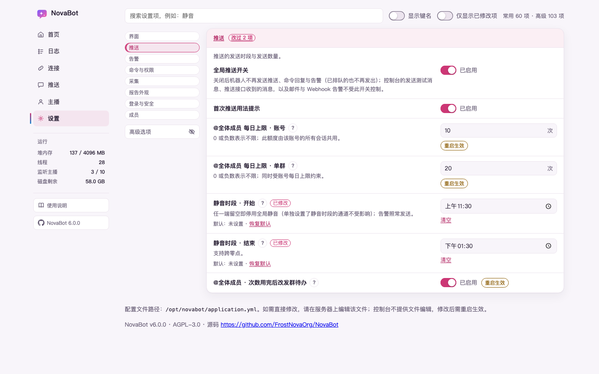
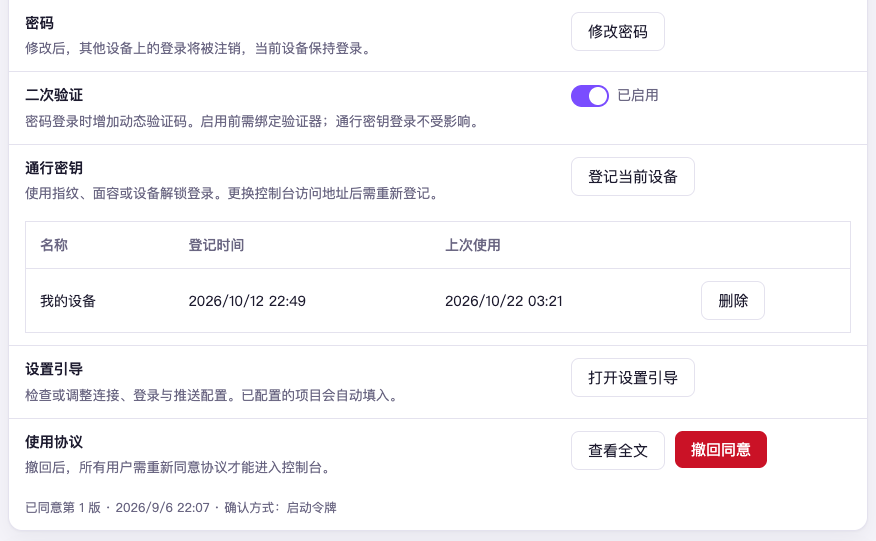

# 第 12 章　设置页怎么用

设置页管着 NovaBot 几乎所有能调的东西，项目多，但你不需要一项项看过去。
它按「你要办的事」分组，平常会动的摆在外面，不常动的工程参数收在「高级」里；不知道在哪一组就直接搜。
每一项都标着改完是马上生效还是要重启。

## 页面怎么排

从侧栏点「设置」进去。左边是分组菜单（窗口窄时挪到页面顶上），点哪一组就滚到哪一组：

| 组 | 管什么 |
|---|---|
| 界面 | 控制台用深色、浅色还是跟随系统 |
| 推送 | 什么时候发、发多少：静音时段、@全体成员 上限等 |
| 告警 | 出了事谁先知道（见[第 10 章](10-quiet-and-alerts.md)） |
| 命令与权限 | 群里谁能管命令、超级管理员是谁 |
| 采集 | 从直播平台拿数据的方式、数据存到哪 |
| 报告外观 | 报告图与动态图上的东西 |
| 登录与安全 | 控制台自己怎么被访问：密码、二次验证、通行密钥 |

### 常用与高级

每一组里平常会动的项直接摆着；不常动的工程参数（重试间隔、线程数、文件放在哪这类）收在「高级」里，
**默认不显示**。点页头搜索框旁边的「显示高级选项」，高级部分接在常用各组下面出来，
按钮变成「隐藏高级选项」，再点一下收回去。页头右边写着「常用 N 项 · 高级 M 项」。

高级里有「日志与调试」「服务」两整组，还有从别的组里拆出来的「采集 · 高级」「登录与安全 · 高级」这类，
**出问题时才需要动**。左边菜单的「高级」下面照样列着它们，高级收着时点过去，会先把高级打开再滚到那一组。

每一项一行，写着名字和当前的值。多数项的名字下面还有一行字：有的是一句短说明，写改之前就该知道的事
（比如「0 表示关闭」）；有的照旧是整段说明；名字和单位已经说清楚的项，下面就不再写。
名字旁边有个 **?** 的，点它（或用键盘移到它上面）能看到完整说明，按 Esc 或点别处关上。
名字旁边还有几个小标记：

- **立即生效** 或 **重启生效**：改完什么时候起作用。一组全都要重启的，组标题上写一句「这一组改了都要重启」，不再逐项标
- **已改**：这一项跟出厂默认值不一样
- **⚠**：改错了后果不小的项。改到危险的那一档时会先弹窗问一句，点取消就退回原值

改过的项下面有一行「默认：…」，点「恢复默认」就改回出厂值。密码一类的项没有这个按钮。

几种特别的格子：

- **静音时段**的开始、结束是时间框，直接选几点几分；旁边的「清空」把它清掉，两项有一项空着就是不设静音。
  配置文件里要是手写过时间框认不出的写法（比如 `8:00` 没补零），框会是空的，下面写一句
  「配置文件里的值「8:00」认不出……现在不生效」——不是本来就没设，是写法不对，重新选一次再保存就好
- **文件位置**（凭据文件、图标图片这类）用等宽字显示，`l` 和 `1`、`O` 和 `0` 好认
- **告警**组里的 QQ、Webhook、邮件几张卡默认收着，只露出名字和「已配置／未配置」；点标题展开。
  从首页「告警有死角」那条点「去配」过来时，卡会自动展开；之前在设置页搜过的词与「只看改过的」会先清掉，
  免得要去的那一组被旧搜索藏住



## 找一项设置：搜

页顶的搜索框写着「搜设置，例如：静音」。输入的字会拿去比对每一项的**名字、说明和配置键**，
不分大小写。没有命中的组整组藏起来，菜单里也跟着藏；命中的项在收起的高级里时，
高级会自动出来，命中告警卡里的内容时那张卡也会展开。旁边会写「匹配 N 项」。
不想看高级里的命中，点「隐藏高级选项」，这次搜索就不再自动打开它，换个搜索词再重新算。

搜索框旁边还有两个开关：

- **只看改过的**：只留跟默认值不一样的项，想知道「我到底改过什么」时用
- **显示键名**：在每项下面显示它在配置文件里的键名，要对着配置文件找时用

## 改完怎么保存

改了任何一项，页面底部会出现一条栏，写着「N 处改动 · 其中 M 处需重启生效」，
右边是「放弃」和「保存」：

- **保存**：保存前会先检查填得对不对，有问题会列出「请先修正以下问题：」，一条都不存
- **放弃**：会先问一句，确认后所有没保存的改动回到上次保存时的样子

保存后，标「立即生效」的项当场起作用；标「重启生效」的要等程序重启。
这时底栏会一直留着「N 处改动需重启生效」，提醒你还没重启。控制台上没有重启按钮，
按你装它的方式重启程序即可，比如用 Linux 一键安装的，在服务器上执行：

```bash
sudo systemctl restart novabot@<版本>
```

改完又后悔了、把值改回程序启动时的原样再保存，这一项的「需重启」提醒就消失——
重启后读到的跟现在一样，没什么要生效的了。这有一条前提：程序启动时，这一项
已经写在配置文件里。启动时文件里没写、一直用默认值的那项，改出去再改回默认值，
提醒不会消失，会一直留到重启；那一次重启其实什么都没变，重启后提醒自然收起。

每次保存，时间线上都会记一条「设置即时生效」或「设置待重启」（见[第 11 章](11-where-to-see-what-happened.md)）。

### 改动存到了哪

存进安装目录根上的配置文件 `application.yml`（一键安装的机器程序在
`releases/<版本>/` 下，配置不在那里）。**只改动过的那几行**，
你在文件里手写的注释、空行和顺序都会留着。

每次保存前自动备份一份原文件，文件名后面带上保存时刻，默认留最近 10 份
（设置项「备份保留份数」）。**控制台上没有「回滚」按钮**，要退回某一份，
到服务器上把那份备份改回原名，再重启。

页面最底下写着配置文件的完整路径，点一下就复制。少数结构复杂的项界面上改不了，
会写明「请到服务器上改配置文件」，改完同样要重启。

## 换深色、浅色

「界面」组里有三个按钮：「跟随系统」「浅色」「深色」，点了马上变，不用保存。
这个选择**只记在当前浏览器里**，不进配置文件，换台电脑或换个浏览器要再选一次；
反过来，手机上手动设成深色、电脑上跟着系统走，两边互不覆盖。
同一个浏览器开着几个控制台标签时，一边换了，别的标签跟着换，正在填的内容不受影响。

## 登录与安全

这一组管控制台自己的门锁。这里的每一项都是**点按钮当场办完**，不经过底栏的「保存」。

还没设过密码时，这一组只写一句
「这台机器还没设密码，因此不出登录页，进来就是控制台。要上锁的话，到设置引导页走第 1 步。」
下面只剩「使用协议」一张卡——先去把锁装上（见[第 4 章](04-first-open.md)）。



### 改密码

1. 在「密码」那一行点「修改密码」
2. 填「现在的密码」「新密码」「再输一遍」，新密码至少 8 个字符
3. 确认后当场生效

改完之后，**别的设备上已经登录的都会被注销**，你正在用的这一个留着。
所以怀疑密码泄露时，改一次密码就等于把别人都踢了出去。

这里填的是控制台的密码，不是机器人程序（比如 NapCat）界面的口令。

### 二次验证

开了之后，用密码登录时还要再填一个手机验证器应用上的 6 位数字。

打开：

1. 把「二次验证」的开关拨到开
2. 用任意验证器应用扫出现的二维码；不方便扫码的，照着旁边那串密钥手动输入
3. 填「现在的密码」和验证器给出的「6 位数字」，点「确认开启」

中途点「取消」就退回原样，什么都不变。

关闭：把开关拨到关，同样填「现在的密码」和验证器此刻的「6 位数字」，点「确认关闭」。
关掉后那把密钥一并清掉，验证器里那一条可以删了；以后再开要重新扫码。

二次验证只管**用密码登录**这一条路。用通行密钥登录不经过它。

### 通行密钥

登记之后，登录时按一下指纹或面容就进来了，不用输密码。

1. 在要登记的那台设备上打开控制台，到「通行密钥」那一行点「登记这台设备」
2. 先输一次「当前密码」，证明是你本人
3. 按浏览器或系统的提示，用指纹、面容或设备密码确认

登记过的会列在下面，写着名字、登记时间、上次使用时间；不再用的点「删除」，
删了以后那台设备就只能用密码进。

> [!NOTE] 通行密钥认的是**你打开控制台用的地址**。换了地址（比如从局域网地址换成域名）
> 要重新登记，旧的那把在新地址上用不了。

### 退出登录

侧栏最底下是「退出登录」，只退当前这个浏览器。

要把所有设备上的登录一起退掉（比如在别人的电脑上登过、忘了退），点「退出全部设备」，
它会连你当前这一个也一起注销。

### 输错太多次会被锁

同一个来源连续输错 5 次，这个来源会被锁 15 分钟（两次输错隔了 15 分钟以上，就从头数）。
锁的那一刻错误次数清零，解锁后要再连续输错满 5 次才会再锁；每多锁一次，锁的时间翻一倍（15 分钟、30 分钟、1 小时……），最长锁 6 小时。
锁着的时候**即使输对了也进不去**，登录页会写还要等多久。

这不代表密码错了，别急着去改密码，等到点再试。锁的是来源，所以通行密钥那条路在锁定期间也一样进不去。

### 其他几项

- **设置引导**：这一行点「打开设置引导」，从第 1 步起再走一遍那五步，已经配好的东西不会被清掉；步骤上的勾表示已有配置，并不代表这一次重新验证过
- **使用协议**：点「查看全文」在弹窗里看全文；「撤回同意」会先问一句

要给外部面板发只读访问令牌，不在这一组，在「连接」页的「外部面板」卡片上点「签发令牌」，
同样要再输一次当前密码。

## 接下来

后面两章讲升级与备份、遇到问题怎么排查：[第 13 章　升级与备份](13-upgrade-and-backup.md)。
